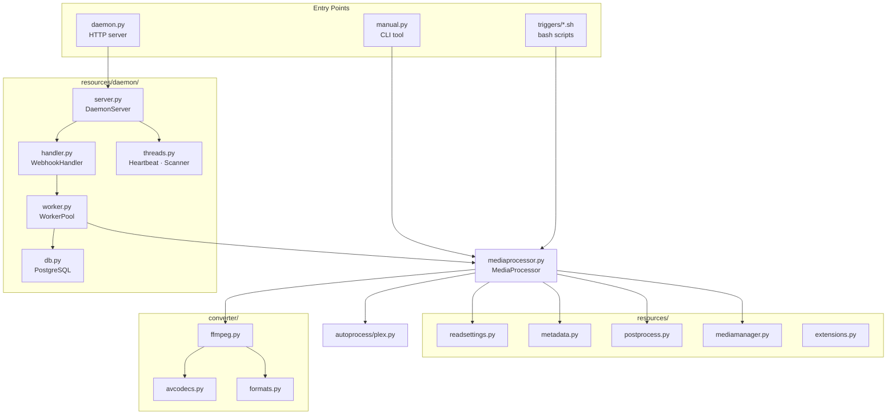
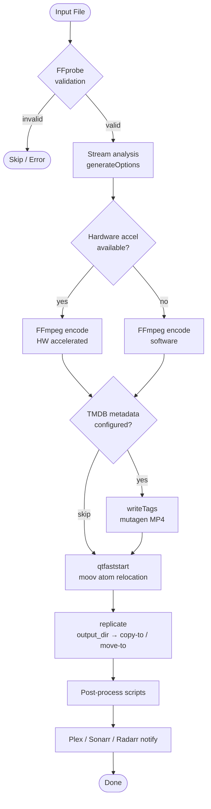

# SMA-NG — Next-Generation Media Automator


Automated media conversion, tagging, and integration pipeline. Converts media files to MP4/MKV using FFmpeg with
hardware acceleration, tags them with TMDB metadata, and integrates with media managers and download clients.

This page is a short, all-in-one overview. The per-topic pages are canonical; where this page and a topic page
disagree, the topic page wins:
[Getting Started](getting-started.md), [Configuration](configuration.md), [Daemon Mode](daemon.md),
[Integrations](integrations.md), [Deployment](deployment.md), [Troubleshooting](troubleshooting.md).

## Table of Contents

- [Requirements](#requirements)
- [Quick Start](#quick-start)
- [Architecture](#architecture)
- [Configuration Reference](#configuration-reference)
- [CLI Usage (manual.py)](#cli-usage)
- [Repairing media without transcoding](#repairing-media-without-transcoding)
- [Running from the Docker host](#running-from-the-docker-host)
- [Daemon Mode](#daemon-mode)
  - [Starting](#starting)
  - [Concurrency](#concurrency)
  - [Web Dashboard](#web-dashboard)
  - [API Endpoints](#api-endpoints)
  - [Webhook Request Formats](#webhook-request-formats)
  - [Authentication](#authentication)
  - [Path-Based Configuration](#path-based-configuration)
  - [Per-Config Logging](#per-config-logging)
  - [Scheduled Directory Scanning](#scheduled-directory-scanning)
  - [Job Persistence (SQLite or PostgreSQL)](#job-persistence-sqlite-or-postgresql)
  - [Job Timeout](#job-timeout)
  - [Graceful Shutdown](#graceful-shutdown)
- [Media Manager Integration](#media-manager-integration)
- [Download Client Integration](#download-client-integration)
- [Docker Compose Quick Start](docker-compose-quickstart.md)
- [Environment Architecture](environment-architecture.md)
- [Hardware Acceleration](#hardware-acceleration)
- [Multi-Instance Deployment](multi-instance-deployment.md)
- [Library Audit](library-audit.md)
- [Processing Pipeline](#processing-pipeline)
- [Module Reference](#module-reference)
- [Supported Codecs](#supported-codecs)
- [Post-Process Scripts](#post-process-scripts)
- [Deployment (mise)](#deployment-mise)
- [Troubleshooting](#troubleshooting)
- [Migrating from sickbeard_mp4_automator](migration.md)

---

## Requirements

- Python 3.12+
- FFmpeg and FFprobe (system install, or set `daemon.ffmpeg-dir` / `base.converter.ffmpeg`)
- Python packages: declared in `pyproject.toml` (the source of truth). `mise run setup:deps` installs them into
  `venv/`; without mise run `pip install .`.

Optional extras (`pip install ".[extra]"`, or `mise run setup:deps:all` for everything):

| Extra         | Adds                                                                       |
| ------------- | -------------------------------------------------------------------------- |
| `postgres`    | `psycopg2-binary` for PostgreSQL job persistence and cluster mode          |
| `qbittorrent` | qBittorrent client library                                                 |
| `deluge`      | Deluge client library                                                      |
| `openvino`    | OpenVINO runtime for the analyzer                                          |
| `dev`         | pytest, ruff, pre-commit, and other lint/test tooling (`setup:deps:dev`)   |

`setup/requirements*.txt` still exist for `pip install -r` workflows; `setup/requirements.txt` mirrors the base
dependencies plus the `postgres` extra and is kept in sync by a test.

## Quick Start

### With mise (recommended)

[mise](https://mise.jdx.dev/) is a dev-tool manager. Install it once, then:

```bash
# Clone and set up
git clone <repo> && cd sma

# Install Python 3.12, create venv, install dependencies
mise install
mise run setup:deps

# Generate config (auto-detects GPU)
mise run config:generate

# Test a conversion
mise run media:convert -- /path/to/file.mkv

# Start the daemon
mise run daemon:start
```

### Without mise

```bash
git clone <repo> && cd sma
python3 -m venv venv && source venv/bin/activate
pip install ".[postgres]"

# Generate config with auto GPU detection
mise run config:generate

# Or copy sample and edit manually
cp setup/sma-ng.yml.sample config/sma-ng.yml
$EDITOR config/sma-ng.yml

# Test a conversion
python manual.py -i /path/to/file.mkv -a

# Start the daemon
python daemon.py --host 0.0.0.0 --port 8585
```

---

## Architecture

A single-host install runs the components shown below. In **cluster mode**,
multiple nodes each run an identical daemon stack (server + worker pool +
heartbeat) sharing one PostgreSQL `jobs` / `cluster_nodes` / `node_commands`
table — see [Daemon Mode → Cluster Mode](daemon.md#cluster-mode) for the
internals and [Cluster Operations](cluster-operations.md) for the operator
runbooks (bootstrap, roll a config, zero-loss upgrade, drain a node,
recover from failure).



### Data Flow



---

## Configuration Reference

All configuration lives in one YAML file, `config/sma-ng.yml`. Copy it from `setup/sma-ng.yml.sample` or generate it
with `mise run config:generate` (auto-detects the GPU). Pass `-c/--config` to commands that support an alternate path.
INI configs and flat-shape YAML (top-level `converter:`, `video:`) are not supported.

The file has four top-level buckets, written in kebab-case:

```yaml
daemon:    # daemon-only runtime settings: host, port, db-url, routing, scan-paths, ...
base:      # default conversion settings: converter, video, audio, subtitle, metadata, ...
profiles:  # named overlays applied on top of base (for example rq, lq)
services:  # Sonarr / Radarr / Plex / Emby / Jellyfin / Autoscan instances, keyed <type>.<instance>
```

- `manual.py` reads `base`, `profiles`, and `services`; the daemon also reads `daemon`.
- A profile is deep-merged onto `base`: nested blocks merge key by key, while scalars and lists replace the base
  value wholesale. Sections a profile omits inherit from `base`.
- Daemon settings resolve as CLI flag, then `sma-ng.yml`, then the built-in default. The daemon reads no `SMA_*`
  environment variables for runtime configuration.
- The pydantic schema in `resources/config_schema.py` is the source of truth for defaults and types. Unknown keys log
  a `WARNING Unknown config key: <dotted.path>`.

Inspect and validate the effective config without converting anything:

```bash
mise run config:validate                          # schema, unknown keys, routing refs, service completeness
mise run config:show -- --profile rq              # effective resolved config for a profile
mise run config:show -- --input /path/to/file.mkv # print the FFmpeg command that would run
```

Where to find each section:

| Topic                                       | Reference                                                                     |
| ------------------------------------------- | ----------------------------------------------------------------------------- |
| Layout, schema rules, validation            | [configuration.md](configuration.md#four-bucket-layout)                       |
| `base.converter` (paths, output, naming)    | [configuration.md](configuration.md#baseconverter)                            |
| Output collisions and overwrite safety      | [configuration.md](configuration.md#output-naming-and-overwrite-safety)       |
| Full-software fallback ladder               | [configuration.md](configuration.md#full-software-fallback)                   |
| `base.video`, `base.hdr`, QSV/VAAPI blocks  | [configuration.md](configuration.md#basevideo)                                |
| `base.audio`, sorting, universal audio      | [configuration.md](configuration.md#baseaudio)                                |
| `base.subtitle`                             | [configuration.md](configuration.md#basesubtitle)                             |
| `base.metadata`, `base.naming`, permissions | [configuration.md](configuration.md#basemetadata)                             |
| Profiles, concurrency caps, priority        | [configuration.md](configuration.md#profiles)                                 |
| `services` (Sonarr, Radarr, Plex, ...)      | [configuration.md](configuration.md#services)                                 |
| `daemon` keys and routing                   | [daemon.md](daemon.md#top-level-daemon-keys)                                  |

---

## CLI Usage

### manual.py

```bash
# Basic conversion with auto-tagging
python manual.py -i /path/to/file.mkv -a

# Specify TMDB ID for movies
python manual.py -i /path/to/movie.mkv -tmdb 603

# TV episode with TVDB ID
python manual.py -i /path/to/episode.mkv -tvdb 73871 -s 3 -e 10

# Batch process a directory
python manual.py -i /path/to/directory/ -a

# Preview conversion options (no conversion)
python manual.py -i /path/to/file.mkv -oo

# List supported codecs
python manual.py -cl

# Use a named profile from the config file
python manual.py -i /path/to/file.mkv -a -c config/sma-ng.yml --profile rq

# Force re-encode even if format matches
python manual.py -i /path/to/file.mp4 -a -fc

# Convert without tagging
python manual.py -i /path/to/file.mkv -a -nt

# Tag only (no conversion)
python manual.py -i /path/to/file.mp4 -to

# Skip file operations (no move, no copy, no delete)
python manual.py -i /path/to/file.mkv -a -nm -nc -nd

# Batch with processed archive (skip already-done files)
python manual.py -i /path/to/directory/ -a -pa archive.json

# Audit a library path for damaged or stale files (exits non-zero when findings exist)
python manual.py -i /path/to/library --audit
```

After conversion, `manual.py` triggers a rescan on the Sonarr/Radarr instance whose `path` matches the output file.
Input paths are routed through `daemon.routing` like daemon jobs, so the matching profile is applied automatically;
`--profile` overrides it.

### All Options

| Flag    | Long                      | Description                                                                |
| ------- | ------------------------- | -------------------------------------------------------------------------- |
| `-i`    | `--input`                 | Input file or directory                                                    |
| `-c`    | `--config`                | Alternate config file                                                      |
| `-p`    | `--profile`               | Apply a named profile (overrides the routed profile)                       |
| `-a`    | `--auto`                  | Auto mode (no prompts, guesses metadata with guessit)                      |
| `-s`    | `--season`                | Season number                                                              |
| `-e`    | `--episode`               | Episode number (repeat for multi-episode: `-e 1 -e 2`)                     |
| `-tvdb` | `--tvdbid`                | TVDB ID                                                                    |
| `-imdb` | `--imdbid`                | IMDB ID                                                                    |
| `-tmdb` | `--tmdbid`                | TMDB ID                                                                    |
|         | `--tv` / `--movie`        | Force guessit to treat the input as a TV episode / a movie                 |
| `-nm`   | `--nomove`                | Disable move-to and output-directory                                       |
| `-m`    | `--moveto`                | Override move-to path (mutually exclusive with `-nm`)                      |
| `-nc`   | `--nocopy`                | Disable copy-to                                                            |
| `-nd`   | `--nodelete`              | Disable original file deletion                                             |
| `-nt`   | `--notag`                 | Disable metadata tagging                                                   |
| `-to`   | `--tagonly`               | Tag only, no conversion                                                    |
| `-np`   | `--nopost`                | Disable post-process scripts                                               |
| `-pr`   | `--preserverelative`      | Preserve relative directory structure                                      |
| `-pse`  | `--processsameextensions` | Reprocess files already in the target format                               |
| `-fc`   | `--forceconvert`          | Force conversion + process-same-extensions                                 |
| `-fr`   | `--forcereencode`         | Force the video stream to be re-encoded even when its codec is accepted    |
| `-oo`   | `--optionsonly`           | Show conversion options, don't convert                                     |
| `-cl`   | `--codeclist`             | List all supported codecs                                                  |
| `-o`    | `--original`              | Original source/release filename, used for guessing                        |
| `-ms`   | `--minsize`               | Minimum file size                                                          |
| `-pa`   | `--processedarchive`      | Processed-files archive; already processed files are skipped               |
|         | `--audit`                 | Run a library audit on the input path (see [Library Audit](library-audit.md)) |
|         | `--repair-hybrid`         | Repair stretched hybrid-aspect MP4s: `remux` (default) or `reencode`       |
|         | `--recycle-failed`        | With `--audit`: move media that fails ffprobe to the recycle-bin           |
|         | `--job-id`                | Daemon job id for log correlation; set by the daemon worker                |
|         | `--version`               | Print the version and exit                                                 |

Run `python manual.py --help` for the authoritative list.

---

## Repairing media without transcoding

`repair.py` fixes stream-level damage by remuxing with `-c copy`. It never re-encodes. It drops data streams
(`tmcd` timecode, stray `bin_data`), streams FFprobe cannot identify, and artwork (attached pictures, cover art
demoted to an `mp4v` video track, MKV image attachments), and it stamps a corrective display aspect ratio on
stretched hybrid-aspect files. Files that already probe as normal are left alone.

```bash
python repair.py -n /mnt/unionfs/Media/TV        # dry run: report what would change
python repair.py /path/to/file.mp4 /path/to/dir   # repair in place
mise run media:repair -- -n /path/to/file-or-dir  # same via mise
```

| Flag              | Effect                                                  |
| ----------------- | ------------------------------------------------------- |
| `-n`, `--dry-run` | Report what would be repaired; change nothing           |
| `-c`, `--config`  | Alternate `sma-ng.yml` path (disables per-path routing) |
| `--no-plex`       | Skip the Plex refresh after repairs                     |
| `-v`, `--verbose` | Debug logging                                           |

Without `-c`, each file is routed to the profile the daemon would convert it with, so `output-directory`,
`temp-extension`, and output permissions (`chmod`, `uid`, `gid`) apply as they do for a conversion. The repaired copy
is written to the temp file, re-probed, and only moved over the original when the kept streams, duration, and
chapters match; otherwise the original is untouched. The exit code is 1 when a path is missing or any repair fails.

The library audit reports the same damage as `stream_damage` findings and can fix them automatically with
`daemon.audit.auto-fix.stream-damage: true`. See [Library Audit](library-audit.md) and
[Repairing damaged media without transcoding](troubleshooting.md#repairing-damaged-media-without-transcoding).

---

## Running from the Docker host

`sma` runs SMA-NG's tools on a Docker host without a checkout, Compose or Python; Docker is the only requirement:

```bash
curl -fsSL https://raw.githubusercontent.com/newdave/sma-ng/main/install-smang.sh | sh
```

```bash
sma convert /mnt/media/Movies/film.mkv   # manual.py -a -i <file>
sma preview ~/Downloads/film.mkv         # manual.py -a -i <file> -oo
sma repair -n /mnt/media/TV              # repair.py ...
sma audit /mnt/media/Movies              # manual.py --audit -i <path>
sma shell                                # bash with the current directory mounted
sma upgrade                              # update the image and sma together
```

- Each command runs in a throwaway container that mounts the paths you name (anywhere on the host), the directories
  `sma-ng.yml` writes to, and the config directory (`/opt/sma/config`; `~/.local/share/sma/config` on macOS),
  then removes itself.
- It runs as your user, with `/dev/dri` and NVIDIA GPUs passed through when present.
- Exit codes: the tool's own code, `2` bad path or usage, `3` Docker unreachable, `5` run `sma upgrade`.

The [`sma` CLI Quick Start](sma-cli-quickstart.md) covers options, mounts, scripting, upgrading and troubleshooting.

---

## Daemon Mode

The daemon runs an HTTP server that accepts webhook requests to queue conversions. Jobs are persisted to SQLite or
PostgreSQL, workers process them in the background, and a web dashboard shows live status. The full reference is
[daemon.md](daemon.md); the sections below are a summary.

### Starting

```bash
# Basic (binds to 127.0.0.1:8585)
python daemon.py

# Production: listen on all interfaces, multiple workers
python daemon.py \
  --host 0.0.0.0 \
  --port 8585 \
  --workers 4 \
  --api-key YOUR_SECRET_KEY \
  --daemon-config config/sma-ng.yml \
  --logs-dir logs/ \
  --ffmpeg-dir /usr/local/bin

# Validate configs and option generation, then exit
python daemon.py --smoke-test
```

Each setting resolves as CLI flag, then the `daemon:` block of `sma-ng.yml`, then the built-in default. An explicit
flag always wins. See [daemon.md](daemon.md#starting) for the additional flags (`--job-timeout`,
`--heartbeat-interval`, `--stale-seconds`, `--version`).

### Concurrency

`--workers` (or `daemon.workers`) controls how many conversions run at the same time; excess jobs queue. Profiles can
cap their own concurrency and weight their cost against a shared budget so one slow profile cannot starve the rest.

```text
Job 1: /TV/show.mkv      -> sma-ng.yml profile rq [starts immediately]
Job 2: /Movies/film.mkv  -> sma-ng.yml profile lq [starts immediately]
Job 3: /TV/other.mkv     -> sma-ng.yml profile rq [waits for an available worker]
```

```bash
curl http://localhost:8585/health
```

See [daemon.md](daemon.md#concurrency) and [profile concurrency caps](configuration.md#profiles).

### Web Dashboard

Open `http://localhost:8585/` (redirects to `/dashboard`). It shows job statistics, active and waiting jobs with
progress, cluster nodes (PostgreSQL mode), config mappings, a filterable job history with requeue/cancel actions, a
Submit Job form with path autocomplete, a log viewer, and admin node controls at `/admin`. Metrics are at `/metrics`.

### API Endpoints

The route table (including `/jobs`, `/logs`, `/library/*`, `/reload`, `/restart`, and `/shutdown`) is in
[daemon.md](daemon.md#api-endpoints), and the machine-readable spec is `docs/openapi.yaml`. Common calls:

| Method | Path                | Auth   | Description                                                   |
| ------ | ------------------- | ------ | ------------------------------------------------------------- |
| `GET`  | `/health`           | No     | Health check with job stats                                   |
| `GET`  | `/status`           | Partly | Minimal without credentials; cluster detail with a valid key  |
| `GET`  | `/jobs`             | Yes    | List jobs. Query: `?status=pending&limit=50&offset=0`         |
| `POST` | `/webhook/generic`  | Yes    | Submit a conversion job (file or directory path)              |
| `POST` | `/webhook/sonarr`   | Yes    | Native Sonarr webhook                                         |
| `POST` | `/webhook/radarr`   | Yes    | Native Radarr webhook                                         |
| `POST` | `/reload`           | Yes    | Reload the `daemon:` block without restarting                 |
| `POST` | `/shutdown`         | Yes    | Graceful, bounded shutdown                                    |

### Webhook Request Formats

```bash
# Plain text body
curl -X POST http://localhost:8585/webhook/generic \
  -H "X-API-Key: SECRET" \
  -d "/path/to/movie.mkv"

# JSON body with extra manual.py arguments
curl -X POST http://localhost:8585/webhook/generic \
  -H "X-API-Key: SECRET" \
  -H "Content-Type: application/json" \
  -d '{"path": "/path/to/movie.mkv", "args": ["-tmdb", "603"]}'

# JSON with config override (bypasses path matching)
curl -X POST http://localhost:8585/webhook/generic \
  -H "X-API-Key: SECRET" \
  -H "Content-Type: application/json" \
  -d '{"path": "/path/to/movie.mkv", "config": "/custom/sma-ng.yml"}'
```

### Authentication

The API key resolves as `--api-key`, then `daemon.api-key` in `sma-ng.yml`; with neither set, authentication is
disabled. Send it as `X-API-Key: SECRET` or `Authorization: Bearer SECRET`.

- Public endpoints: `/`, `/dashboard`, `/admin`, `/metrics`, `/health`, `/status`, `/docs`, `/favicon.png`.
- The dashboard, admin, and metrics pages are HTML shells; the API key is never embedded in the page. When a key is
  configured, the first `401` opens one in-page dialog; the key is kept in `localStorage` for the daemon's address
  and sent as `X-API-Key` on every request. Cancel stops asking (an "API key required" button reopens the dialog).
- `/status` is minimal without credentials (`status`, `version`, aggregate `jobs` counts). Node ids, hosts, active
  jobs, and paths require a valid key.
- `/browse` is limited to the configured routing and scan roots. Request bodies over 1 MiB are rejected with `413`.

### Path-Based Configuration

Each inbound path is matched against `daemon.routing` (longest prefix wins) to pick a profile and the services to
notify after conversion. `path-rewrites` normalise the path first.

```yaml
daemon:
  path-rewrites:
    - from: /mnt/local/Media
      to: /mnt/unionfs/Media
  routing:
    - match: /mnt/unionfs/Media/TV
      profile: rq
      services: [sonarr.main]
    - match: /mnt/unionfs/Media/Movies/4K
      profile: rq
      services: [radarr.main, plex.main]
    - match: /mnt/unionfs/Media/Movies
      profile: lq
      services: [radarr.main]
```

`/mnt/unionfs/Media/Movies/4K/film.mkv` matches the `Movies/4K` rule, not `Movies`. With `daemon.strict-routing: true`
an unmatched path is refused (HTTP 400 `no_routing_match`); otherwise it converts with bare `base` and logs a
`[routing-miss]` warning. See
[daemon.md](daemon.md#path-routing) and [Top-Level `daemon` Keys](daemon.md#top-level-daemon-keys).

### Per-Config Logging

Each config gets its own rotating log file in `logs/`, named after the config file stem
(`config/sma-ng.yml` writes `logs/sma-ng.log`; 10 MB, 5 backups). The daemon also exposes `/logs` for browsing and
live-tailing, and writes FFmpeg failure sidecars. See [daemon.md](daemon.md#per-config-logging).

### Scheduled Directory Scanning

The daemon can periodically scan directories and queue new media automatically:

```yaml
daemon:
  scan-paths:
    - path: /mnt/local/Media
      interval: 3600
      rewrite-from: /mnt/local/Media
      rewrite-to: /mnt/unionfs/Media
      enabled: true
```

Files already recorded in the `scanned_files` table are skipped on later scans. Only extensions listed in
`daemon.media-extensions` are eligible; `.mp4` is excluded by default so converted output is not reprocessed.
For a manual batch submission use `scripts/sma-scan.sh`:

```bash
bash scripts/sma-scan.sh /mnt/unionfs/Media/Movies             # submit unscanned files
bash scripts/sma-scan.sh /mnt/unionfs/Media/Movies --dry-run   # show what would be submitted
bash scripts/sma-scan.sh /mnt/unionfs/Media/Movies --reset     # ignore scan history
```

The `/scan`, `/scan/filter`, and `/scan/record` endpoints are described in
[daemon.md](daemon.md#scheduled-directory-scanning).

### Job Persistence (SQLite or PostgreSQL)

Set `daemon.db-url` in `sma-ng.yml`; there is no `--db-url` flag and the connection is not read from the
environment. An empty `db-url` makes startup fail fast.

- SQLite (`sqlite:////data/sma-ng.db`) for single-node deployments. Non-`-pg` Docker profiles default to it.
- PostgreSQL (needs the `postgres` extra) for clusters: shared job queue, node heartbeats and approval, cluster logs,
  metrics, and the library audit.

```bash
curl http://localhost:8585/stats
curl "http://localhost:8585/jobs?status=pending"
curl -X POST "http://localhost:8585/cleanup?days=7"
```

See [daemon.md](daemon.md#job-persistence), [daemon.md](daemon.md#cluster-mode), and
[Cluster Operations](cluster-operations.md).

### Job Timeout

Each conversion runs `manual.py` (and the `ffmpeg` it spawns) in its own process group under a per-job watchdog.
When `daemon.job-timeout-seconds` (default `7200`, or `--job-timeout`) elapses, the watchdog sends `SIGTERM` to the
whole process tree, then `SIGKILL` after 5 seconds, and the job fails with `Job timed out after Ns`. Cancelling a
running job kills its tree the same way, and a cancel or requeue from another node is noticed within about 10
seconds. `0` disables the timeout. See [daemon.md](daemon.md#job-timeout).

### Graceful Shutdown

`POST /shutdown` (or SIGTERM, which the Docker entrypoint forwards) stops accepting new jobs and drains active
conversions. The drain is bounded: it waits up to the job timeout plus 5 minutes (24 hours when the timeout is `0`),
then kills whatever is still running and leaves those jobs `running` so they are requeued (by node-offline recovery in
cluster mode, or on the next start for SQLite). `POST /restart` and SIGHUP drain the same way and re-exec with the
same arguments.

```bash
curl -X POST http://localhost:8585/shutdown -H "X-API-Key: SECRET"
```

---

## Media Manager Integration

Sonarr and Radarr can post to the daemon directly (`/webhook/sonarr`, `/webhook/radarr`, recommended) or run the
scripts in `triggers/media_managers/`. Define instances under `services:` and reference them from `daemon.routing`
rules by `<type>.<instance>`; the longest matching `match` prefix selects the profile and the services to notify:

```yaml
services:
  sonarr:
    main:
      url: https://sonarr.example.com
      apikey: abc123
  radarr:
    main:
      url: https://radarr.example.com
      apikey: def456
  plex:
    main:
      url: http://plex.example.com:32400
      token: your-plex-token

daemon:
  routing:
    - match: /mnt/unionfs/Media/TV
      profile: rq
      services: [sonarr.main, plex.main]
    - match: /mnt/unionfs/Media/Movies
      profile: rq
      services: [radarr.main, plex.main]
```

When deploying with `mise run deploy:config`, declare `path`/`profile` (or `routes`) on each instance in
`setup/local.yml` and the routing rules are generated for you.

After an in-place conversion SMA-NG rescans the matching series or movie and imports the converted file so
Sonarr/Radarr do not show it as missing; Plex gets a library refresh, with path mapping available when Plex sees
different mount points. Emby, Jellyfin, and Autoscan are supported too. Setup steps, multiple instances, and
troubleshooting are in [integrations.md](integrations.md); service keys are in
[configuration.md](configuration.md#services).

---

## Download Client Integration

Download clients call bash scripts in `triggers/`, which submit jobs to the daemon via `/webhook/generic`:

| Client      | Script                                                                  |
| ----------- | ----------------------------------------------------------------------- |
| NZBGet      | `triggers/usenet/nzbget.sh` (Settings, Extension Scripts)               |
| SABnzbd     | `triggers/usenet/sabnzbd.sh` (category script in the Scripts folder)    |
| qBittorrent | `triggers/torrents/qbittorrent.sh "%L" "%T" "%R" "%F" "%N" "%I"`        |
| Deluge      | `triggers/torrents/deluge.sh` (Execute plugin, Torrent Complete)        |
| uTorrent    | `triggers/torrents/utorrent.sh %L %T %D %K %F %I %N`                    |

The scripts submit only media files and exit non-zero when a submission fails. Exit codes, timeouts, and per-client
setup are in [integrations.md](integrations.md#download-clients).

---

## Hardware Acceleration

Set `base.video.gpu` to pick the backend. It drives the derived hardware settings (`hwaccels`, decoders, devices,
output formats, and the default `base.video.codec`).

| `gpu` value    | Platform                | Codec examples                           |
| -------------- | ----------------------- | ---------------------------------------- |
| `qsv`          | Intel Quick Sync        | `h265qsv`, `h264qsv`, `av1qsv`           |
| `vaapi`        | Intel / AMD VA-API      | `h265vaapi`, `h264vaapi`, `av1vaapi`     |
| `nvenc`        | NVIDIA                  | `h265_nvenc`, `h264_nvenc`, `av1_nvenc`  |
| `videotoolbox` | Apple Silicon / macOS   | `h265_videotoolbox`, `h264_videotoolbox` |
| empty          | Software (CPU)          | `h265`, `h264`, `av1`                    |

```yaml
base:
  video:
    gpu: qsv
    codec: [h265qsv, h265]
```

- The first codec in the list is used for encoding; the rest are copy-eligible.
- `mise run config:generate` auto-detects the GPU (override with `GPU=nvidia|intel|amd|apple|none`);
  `mise run config:gpu` only reports the detection result.
- If a hardware encode fails, the fallback ladder (`fallback-policy`) retries with adjusted options and, under
  `aggressive`, finishes on the CPU. See [configuration.md](configuration.md#full-software-fallback).

Backend setup, startup validation, and Docker device troubleshooting are in
[hardware-acceleration.md](hardware-acceleration.md).

---

## Processing Pipeline

### Video Decision Tree

1. Source codec in allowed list → **copy** (unless overridden by bitrate/width/level/profile/filter)
2. Bitrate exceeds `max-bitrate` (after `bitrate-ratio` scaling) → **re-encode**
3. Width exceeds `max-width` → **re-encode + downscale**
4. Level exceeds `max-level` → **re-encode**
5. Profile not in whitelist → **re-encode**
6. Burn subtitles enabled → **re-encode**
7. Otherwise → **copy**

### Bitrate Calculation

1. `estimateVideoBitrate()` computes source video bitrate from container total minus audio
2. `bitrate-ratio` scales the estimate per source codec (e.g., H.264 at 0.65x for HEVC target)
3. `crf-profiles` selects CRF/maxrate/bufsize tier based on scaled bitrate
4. `max-bitrate` caps the final result

### Audio Decision Tree

1. Filter by `languages` whitelist + `include-original-language`
2. Filter by `ignored-dispositions`
3. Source codec in allowed list → **copy**; otherwise → **re-encode** to first codec
4. Apply channel limits (`max-channels`), bitrate limits (`max-bitrate`)
5. Sort by `base.audio.sorting` rules
6. Select default stream
7. Optionally generate Universal Audio stream (stereo compatibility)

---

## Module Reference

### converter/avcodecs.py

Codec definitions mapping SMA-NG names to FFmpeg encoders. Each codec class handles its own option parsing and FFmpeg
flag generation.

**Video codecs**: H264, H265, AV1, VP9, MPEG-1/2, H263, FLV, Theora + hardware variants (QSV, VAAPI, NVENC,
VideoToolbox, V4L2M2M, OMX)

**Audio codecs**: AAC, AC3, EAC3, DTS, FLAC, MP3, Vorbis, Opus, PCM variants, TrueHD, ALAC

**Subtitle codecs**: mov_text, SRT, SSA/ASS, WebVTT, PGS, DVDSub, DVBSub, copy

### converter/ffmpeg.py

FFmpeg/FFprobe wrapper. Key classes:

- **MediaInfo** / **MediaStreamInfo** / **MediaFormatInfo**: Parsed probe results. `MediaInfo.cover_art` lists
  artwork streams (attached pictures, cover art demoted to an `mp4v` video track, image attachments) and
  `is_unknown_stream()` flags streams FFprobe could not classify; both feed stream selection and the repair tool.
- **FFMpeg**: Binary wrapper with `probe(fname, posters_as_video=True, framedata=True)` (`framedata=False` skips the
  per-frame probe), `convert()`, `thumbnail()`, codec/hwaccel queries

### converter/formats.py

Container format definitions (MP4, MKV, AVI, WebM, etc.) mapping to FFmpeg muxer names.

### converter/\_\_init\_\_.py

**Converter** class: Orchestrates codec/format selection, builds FFmpeg commands, manages conversion with progress
tracking.

### resources/mediaprocessor.py

**MediaProcessor**: Core pipeline orchestrator. Key methods:

- `isValidSource()`: FFprobe validation
- `generateOptions()`: Stream analysis to FFmpeg option dict
- `convert()`: Execute FFmpeg; collision-safe (numbers outputs such as `name.2.mp4`, never overwrites), with a
  hardware-to-software fallback ladder whose last tier is a full-software re-encode (`fallback-policy: aggressive`)
- `fullprocess()`: Complete pipeline (validate, convert, tag, relocate, replicate, notify)
- `setAcceleration()`: Hardware accel configuration with bit-depth checks
- `estimateVideoBitrate()`: Source bitrate estimation
- `replicate()`: copy-to / move-to file operations

### resources/media_repair.py

**RepairProcessor**: stream-copy repair used by `repair.py`. `diagnose()` builds a `RepairPlan` (data, unknown, and
artwork streams to drop; corrective aspect ratio), `build_opts()` produces the `-c copy` options, and `verify()`
re-probes the copy before it atomically replaces the original.

### resources/library_audit/

Library auditor. `engine.py` (`AuditEngine`) probes one queue unit, upserts findings, and runs optional auto-fix, and
`run_audit_inline()` backs `manual.py --audit`. `probes.py` holds the per-file checks, including `repair_check()` for
`stream_damage` and `hybrid_aspect`. `enumerator.py`, `kinds.py`, and `recycler.py` walk roots, define finding kinds,
and move files to the recycle-bin. See [Library Audit](library-audit.md).

### resources/naming.py and resources/rename_util.py

`naming.py` is the template-based naming engine (data from Sonarr/Radarr, else FFprobe + guessit + TMDB).
`rename_util.py` backs `rename.py`: it renames already-converted files with those templates, updates `.plexmatch`
sidecars, and triggers a Plex refresh.

### resources/daemon/

- `server.py`: `DaemonServer`, the HTTP server and process lifecycle
- `handler.py`, `routes.py`: request handling and route tables (webhooks, jobs, logs, admin, library)
- `worker.py`: worker pool, job execution, and the timeout watchdog
- `threads.py`: heartbeat, scanner, and library-audit worker threads
- `db.py`: SQLite/PostgreSQL job store, cluster tables, and findings
- `config.py`: `daemon:` settings resolution (CLI flag, then `sma-ng.yml`, then default)

### resources/readsettings.py

**ReadSettings**: Parses `sma-ng.yml` (via `config_loader.py` and the pydantic schema in `config_schema.py`) into
typed attributes, applies profiles, and resolves service instances.

### resources/metadata.py

**Metadata**: TMDB API client + MP4 tagger (via mutagen). Resolves TMDB/TVDB/IMDB IDs, writes iTunes-compatible tags.

### resources/postprocess.py

**PostProcessor**: Discovers and runs the scripts in `post_process/` with the SMA-NG environment variables. See
[Post-Process Scripts](#post-process-scripts).

### resources/log.py

Logging setup with optional INI-based configuration. Core library output goes to stdout/stderr. The daemon writes
per-config rotating log files in `logs/`.

### resources/lang.py

Language code conversion (ISO 639 alpha2/alpha3) via babelfish.

### resources/custom.py

Optional hook points loaded from `config/custom.py`: `validation()`, `blockVideoCopy()`, `blockAudioCopy()`,
`skipStream()`, `streamTitle()`.

### autoprocess/plex.py

Plex library refresh via PlexAPI with path mapping support.

### resources/mediamanager.py

Shared Sonarr/Radarr API helpers. After in-place conversion the daemon issues a two-step chain keyed on the
series/movie ID resolved via `/api/v3/parse`:

1. `RescanSeries` (Sonarr) / `RescanMovie` (Radarr) — re-evaluates known file records and unlinks the now-missing
   original path (extension and/or basename changed during conversion).
2. `DownloadedEpisodesScan` (Sonarr) / `DownloadedMoviesScan` (Radarr) with the converted *file* path and
   `importMode: Move` — imports the new file and links it to the existing series/movie. Without this second step the
   file is orphaned and the episode/movie shows as missing.

When the instance has `force-rename: true`, a `RenameFiles` command is chained after the import completes.

---

## Supported Codecs

Run `python manual.py -cl` for the full list. Key codecs:

### Video

| SMA-NG Name     | FFmpeg Encoder | Notes             |
| --------------- | -------------- | ----------------- |
| `h264`          | libx264        | Software H.264    |
| `h265` / `hevc` | libx265        | Software HEVC     |
| `h264qsv`       | h264_qsv       | Intel QSV H.264   |
| `h265qsv`       | hevc_qsv       | Intel QSV HEVC    |
| `h264vaapi`     | h264_vaapi     | Intel VAAPI H.264 |
| `h265vaapi`     | hevc_vaapi     | Intel VAAPI HEVC  |
| `av1qsv`        | av1_qsv        | Intel QSV AV1     |
| `av1vaapi`      | av1_vaapi      | Intel VAAPI AV1   |
| `h265_nvenc`    | hevc_nvenc     | NVIDIA HEVC       |
| `av1`           | libaom-av1     | Software AV1      |
| `svtav1`        | libsvtav1      | SVT-AV1           |
| `vp9`           | libvpx-vp9     | Software VP9      |

### Audio

| SMA-NG Name | FFmpeg Encoder   |
| ----------- | ---------------- |
| `aac`       | aac / libfdk_aac |
| `ac3`       | ac3              |
| `eac3`      | eac3             |
| `flac`      | flac             |
| `opus`      | libopus          |
| `mp3`       | libmp3lame       |
| `dts`       | dca              |
| `truehd`    | truehd           |

---

## Post-Process Scripts

There are two different things with similar names.

### Hook scripts (`post_process/`)

After each conversion, SMA-NG can run every script in the repository's `post_process/` directory. Enable it with
`base.converter.post-process: true`; set `wait-post-process: true` to wait for each script to exit, and pass `-np` to
`manual.py` to skip them for one run.

- Scripts run in sorted filename order, each as its own process with the daemon's environment plus the variables
  below. A script that fails is logged and does not stop the rest.
- Subdirectories, files starting with `_` (private helpers), files ending in `.txt`, `.log`, `.pyc`, or `.md`, and
  `resources` and `.DS_Store` are skipped. Make scripts executable and give them a shebang.

| Variable       | Description                                                                         |
| -------------- | ----------------------------------------------------------------------------------- |
| `SMA_FILES`    | JSON array of output file paths. The first is the primary file; the rest are copies |
| `SMA_TMDBID`   | TMDB ID (movies and TV)                                                             |
| `SMA_SEASON`   | Season number (TV only)                                                             |
| `SMA_EPISODE`  | First episode number (TV only)                                                      |
| `SMA_EPISODES` | Comma-separated episode numbers (TV only)                                           |

```bash
#!/usr/bin/env bash
# post_process/log_outputs.sh
echo "converted: ${SMA_FILES} (tmdb ${SMA_TMDBID:-n/a})" >> /tmp/sma-post.log
```

The repository no longer ships Plex, Emby, Jellyfin, or iTunes hook examples; use the `services.*` integrations for
library refreshes. `mise run deploy:config` copies `setup/post_process/*.py` into each host's `post_process/`,
except `_`-prefixed helpers such as `_json_helper.py`.

### Download-client and manager scripts (`setup/post_process/`)

`setup/post_process/` holds `sonarr_post_process.sh`, `radarr_post_process.sh`, `nzbget_post_process.sh`,
`sabnzbd_post_process.sh`, `qbittorrent_post_process.sh`, `deluge_post_process.sh`, and `utorrent_post_process.sh`.
They are not hooks: each is a sample script you install into the download client or Sonarr/Radarr, and it submits
the imported file to the daemon's `/webhook/generic` endpoint as `{"path": ..., "args": [...]}` and polls the job
until it finishes. (Releases before this fix posted to a non-existent `/webhook` route and failed.) `_json_helper.py` is their shared,
standard-library-only JSON helper (`get`, `payload`, `sonarr-args`, `radarr-args`) so no inline Python lives in the
shell scripts.

Configure them with environment variables: `DAEMON_HOST` (default `127.0.0.1`), `DAEMON_PORT` (`8585`),
`DAEMON_API_KEY`, `POLL_INTERVAL` (`5` seconds), and `TIMEOUT` (`0`, unlimited). The maintained trigger scripts are in
`triggers/` (see [Download Client Integration](#download-client-integration)); prefer those for new setups.

---

## Deployment (mise)

SMA-NG uses [mise](https://mise.jdx.dev/) as a task runner for both local development and remote deployments.
Runnable tasks are executable scripts under `.mise/tasks/`; `mise.toml` only defines tools and shared environment.

### Local Development Tasks

```bash
mise run setup:deps              # Create venv and install base dependencies
mise run setup:deps:dev          # Install dev + test dependencies
mise run test                    # Run the test suite (alias of test:run)
mise run test:cov                # Tests with coverage and the per-module floor
mise run test:daemon             # Focused daemon/API worker tests
mise run test:deploy             # Focused deploy/config task tests
mise run test:lint               # Ruff linter and bandit scan
mise run test:openapi            # Validate docs/openapi.yaml
mise run dev:lint                # Auto-fix lint issues
mise run dev:format              # Format Python code
mise run dev:precommit           # Run pre-commit checks against all files
mise run config:gpu              # Detect available GPU acceleration
mise run config:generate         # Generate config with auto-detected GPU
mise run config:sample           # Regenerate setup/sma-ng.yml.sample from the schema
mise run config:validate         # Validate the effective config
mise run config:show -- --profile rq   # Show the effective config for a profile
mise run daemon:smoke            # Validate daemon config and exit
mise run daemon:start            # Start daemon on 0.0.0.0:8585
mise run media:convert -- /path/to/file.mkv   # Convert a file
mise run media:preview -- /path/to/file.mkv   # Preview options only
mise run media:rename -- /path/to/file-or-dir # Rename using naming templates
mise run media:repair -- -n /path/to/file-or-dir  # Stream-copy repair (dry run)
mise run media:codecs            # List supported codecs
```

#### Docker tasks

```bash
mise run build:docker     # Build image locally (TAG=sma-ng:local to override)
mise run build:run        # Uses daemon.db_url from config/sma-ng.yml
mise run build:shell      # Open shell in locally-built image
mise run build:smoke      # Smoke-test the built image (imports and ffmpeg)
```

### Deployment System

The deploy tasks push code to remote hosts via SSH/rsync and manage the Docker stack.

#### Initial setup

1. Copy `setup/local.yml.sample` to `setup/local.yml` and configure it (this file is gitignored).
   See [`docs/deployment.md`](deployment.md#configuration) for the canonical reference of every
   top-level section. Minimal multi-host example:

```yaml
deploy:
  hosts: [sma-master, sma-worker-1]
  deploy_dir: /opt/sma
  ssh_key: ~/.ssh/id_ed25519_sma
  ffmpeg_dir: /usr/local/bin
  docker_profile: intel

hosts:
  sma-master:
    address: 192.168.1.10
    user: deploy
    docker_profile: intel-pg     # bundled postgres on this host
  sma-worker-1:
    address: 192.168.1.11
    user: deploy

daemon:
  api_key: your_secret_key

base:                            # encoder defaults locked across every host
  video:
    gpu: qsv
    codec: [hevc]
    preset: fast

profiles:                        # overlays selected per routing rule
  rq:
    video:
      crf-profiles: '0:22:1M:2M,2000:22:2M:4M,4000:22:3M:8M,8000:22:6M:8M'
  lq:
    video:
      crf-profiles: '0:22:3M:6M,8000:22:5M:10M'

services:                        # nested <type>.<instance>; auto-builds daemon.routing
  sonarr:
    main:
      url: https://sonarr.example.com
      apikey: abc123...
      path: /mnt/unionfs/Media/TV
      profile: rq
  radarr:
    main:
      url: https://radarr.example.com
      apikey: def456...
      path: /mnt/unionfs/Media/Movies
      profile: rq
```

1. Run first-time setup (generates SSH key, installs Docker, creates the install directory with config/logs/data):

```bash
mise run deploy:setup
```

#### Deploying code

```bash
# Push to main; CI builds and pushes the image. Then deploy it:
mise run deploy:remote

# Deploy a specific image tag
IMAGE=ghcr.io/newdave/sma-ng:main mise run deploy:remote

# Stop Docker services on one host (or many)
HOST=sma-master mise run cluster:stop
HOSTS="sma-master sma-worker-1" mise run cluster:stop
```

Production images are built in CI on push to `main`. Once the GitHub Actions
Docker workflow finishes, `deploy:remote` runs `deploy:config` then
`deploy:docker` per host — regenerating `sma-ng.yml` locally, pulling the
latest image, and recreating the Docker container. It never builds an image
locally. Use `HOST=<name>` or `HOSTS="<name1> <name2>"` to scope a deploy.

Hosts run the Docker image only. Run `mise run deploy:setup` once per host (SSH key, Docker, install dir),
then `deploy:remote` for every change.

#### Rolling config to remote hosts

```bash
mise run deploy:config
```

This task manages `config/sma-ng.yml` on remote hosts without overwriting your customisations.
For each host it:

- **Creates missing configs** from `setup/sma-ng.yml.sample` (auto-detects GPU on first creation)
- **Backs up** `config/` to `.backup/<timestamp>/` before any mutation
- **Merges new keys** from the sample via `yaml_merge.py` (non-destructive)
- **Deep-merges `base:` and `profiles:`** from `setup/local.yml` into the same blocks of
  `sma-ng.yml`. Dicts recurse, lists/scalars overwrite, anything you omit inherits from
  the sample.
- **Stamps `services.<type>.<instance>`** from `setup/local.yml` into `services:` and
  rebuilds `daemon.routing` from every instance carrying both `path` and `profile`
  (longest match first), plus any `daemon.routing` rules in `setup/local.yml` for
  plain folders no service covers
- **Stamps `daemon.api-key` / `daemon.db-url` / `daemon.ffmpeg-dir` / `daemon.node-id`**
  (kebab-case) into `daemon:`
- **Stamps `base.converter.{ffmpeg,ffprobe}`** from the host's resolved `ffmpeg_dir`

`deploy:config` pushes only `sma-ng.yml`; it does not copy post-process scripts.

#### Per-host overrides

Any key from `deploy:` can be overridden for a specific host under `hosts:`:

```yaml
hosts:
  sma-master:
    address: 192.168.1.10
    user: deploy
    deploy_dir: /opt/sma
    ssh_port: 2222
    ffmpeg_dir: /opt/ffmpeg/bin
```

#### Restarting and reloading without deploying

```bash
mise run cluster:restart   # docker compose restart; daemon gets STOP_GRACE_PERIOD (default 2m) to drain
mise run cluster:reload    # POST /reload; hot-reloadable config changes only
```

Jobs still running when the grace period ends are requeued.

#### Summary of deploy tasks

| Task              | Description                                                                          |
| ----------------- | ------------------------------------------------------------------------------------ |
| `deploy:check`    | Verify `setup/local.yml` exists and `deploy.hosts` is set                            |
| `deploy:setup`    | First-time host prep: SSH key, Docker install, install dir with config/logs/data     |
| `deploy:remote`   | Run `deploy:config` then `deploy:docker` (build config locally, recreate Docker)     |
| `deploy:config`   | Build `config/sma-ng.yml` locally per host and push to each `DEPLOY_HOSTS` entry     |
| `deploy:docker`   | Push docker-compose.yml, pull image, `docker compose down` + `up -d --force-recreate`|

Cluster lifecycle: `cluster:start`, `cluster:stop`, `cluster:restart`, `cluster:reload`, `cluster:status`,
`cluster:drain`, `cluster:pause`, `cluster:resume`, `cluster:upgrade` — see
[Cluster Operations](cluster-operations.md).

---

## Troubleshooting

The full guide, including FFmpeg failure classes and their fixes, is [troubleshooting.md](troubleshooting.md).

### Logs

All SMA-NG output goes to stdout/stderr. For Docker deployments follow the container logs:

```bash
sma logs                      # from the Docker host (see "Running from the Docker host")
docker logs -f sma-ng         # equivalent
```

The daemon also writes per-config rotating log files in `logs/` (`config/sma-ng.yml` writes `logs/sma-ng.log`) and
serves them at `/logs`. See [FFmpeg Failure Sidecars](daemon.md#ffmpeg-failure-sidecars) for per-job FFmpeg stderr.

### Common Issues

- **"Invalid source, no video stream detected"**: the file may be corrupt or not media; check the FFprobe path.
  Run `python manual.py --audit -i <dir>` to list unreadable files.
- **Hardware acceleration not working**: check `base.video.gpu`, that the FFmpeg build supports the hwaccel
  (`ffmpeg -hwaccels`), that the render device exists (`ls /dev/dri/renderD128`), and in Docker that the container
  joins the host `render` and `video` groups. See [hardware-acceleration.md](hardware-acceleration.md).
- **Output written as `name.2.mp4`**: an output with that name already existed; SMA-NG numbers outputs instead of
  overwriting. See [configuration.md](configuration.md#output-naming-and-overwrite-safety).
- **Job failed with "Job timed out after Ns"**: the watchdog killed a conversion that exceeded
  `daemon.job-timeout-seconds`; raise it for long encodes. See [Job Timeout](#job-timeout).
- **Conversion produces a larger file**: lower `crf`, set `max-bitrate`, or use `bitrate-ratio` and `crf-profiles`.
- **Sonarr/Radarr not rescanning**: confirm the `services.sonarr.<name>` `url` and `apikey`, `rescan: true`, and that
  a `daemon.routing` rule lists the instance for the file's path.
- **Damaged streams or stretched output**: see [Repairing media without transcoding](#repairing-media-without-transcoding).
- **Docker "Read-only file system"**: every path FFmpeg writes to (output dir, temp dir, media mounts) must be
  bind-mounted read-write into the `sma` service in `docker/docker-compose.yml`.

### Environment Variables

The daemon does not read `SMA_*` environment variables for runtime configuration. Use CLI flags for process-level
options and `sma-ng.yml` for persistent settings. The Docker image's CMD shim is the one exception: it translates
`SMA_WORKERS` into `--workers`.

---

## License

See [license.md](../license.md).
