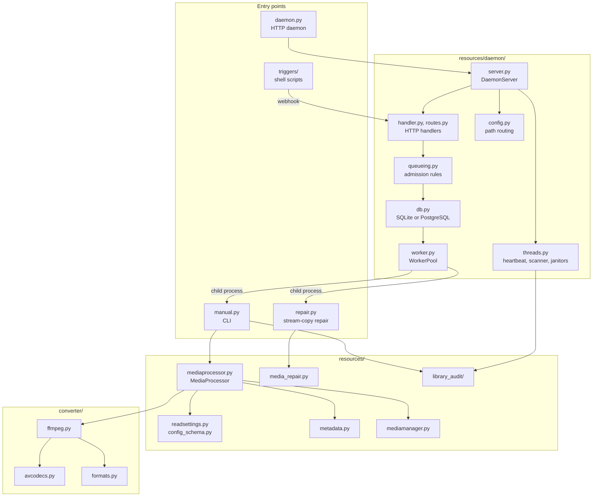
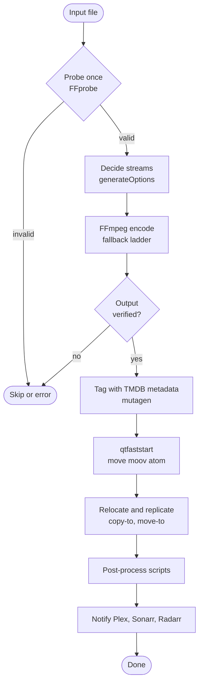

# Architecture

This page describes how the SMA-NG components fit together: the entry points, the daemon package, the conversion
pipeline and a module reference. For the rules that drive stream selection, see
[Configuration](configuration.md#video-decision-tree). For daemon internals, see [Daemon Mode](daemon.md).

## Components

SMA-NG has two entry points that share one conversion pipeline. `manual.py` converts files directly from the command
line. `daemon.py` runs an HTTP server that queues jobs and executes each one in a child process that runs
`manual.py` (or one of the other tools described below). Trigger scripts and the Sonarr/Radarr webhooks only submit
paths to the daemon; they never convert anything themselves.

In cluster mode, several nodes each run the same daemon stack (server, worker pool and heartbeat) against one shared
PostgreSQL database. See [Daemon Mode](daemon.md#cluster-mode) for the internals and
[Cluster Operations](cluster-operations.md) for the operator runbooks.

## Conversion Pipeline

`MediaProcessor.fullprocess()` in `resources/mediaprocessor.py` drives one file through these stages:

Key behaviors:

- **Probe once.** The source is probed a single time and the result is reused by every later stage, including each
  fallback attempt. `FFMpeg.probe(..., framedata=False)` skips the slower per-frame probe when it is not needed.
- **Stream selection by index.** Every remux or conversion drops cover art and unknown or data streams. The pipeline
  selects streams with `MediaInfo.cover_art` and `is_unknown_stream()` and maps them by index, never with type maps
  such as `0:V` or `0:a?`.
- **Fallback ladder.** `_attempt_ladder()` retries a failed encode according to `fallback-policy`. The full
  `aggressive` ladder is hardware encode, `hw_alt` (a same-vendor VAAPI encoder behind a QSV decoder), software
  decode with hardware encode, and finally a full-software re-encode. Other policies stop earlier. The ladder also
  stops immediately when a retry cannot help, for example when the process was killed by a signal or the output
  filesystem failed.
- **Copy fallback.** When a re-encode comes out larger than the source, the pipeline can fall back to a verified
  stream copy instead.
- **Verification.** After FFmpeg exits, the output is probed again. A truncated or stream-less file is renamed to
  `<name>.failed` and the job fails instead of shipping a damaged file.
- **No overwrites.** An existing output is never overwritten; the new file is numbered instead (for example
  `name.2.mp4`).
- **Bounded stderr.** `converter/ffmpeg.py` keeps only a bounded head and tail of FFmpeg's stderr in memory, so a
  noisy or looping encode cannot exhaust memory. The full text is written to a sidecar file when a conversion fails.

## Daemon Flow

1. A request reaches `handler.py` (for example `POST /webhook/sonarr`, `POST /jobs`, or a scanner pass in
   `threads.py`).
2. `queueing.py` applies the shared admission rules to every path, whichever way it was discovered: normalize the
   path, skip duplicates, skip files that already have the target extension or sit in the recycle bin, and skip files
   completed within the configured window.
3. `config.py` routes the path to a config and profile by matching it against the routing rules built from the
   `services:` section.
4. The job is stored in the job database. SQLite is used for a single node and PostgreSQL for clusters.
5. A worker in `worker.py` claims the job and runs the matching tool as a child process, as defined in
   `job_kinds.py`: `convert` and `preview` and `audit` run `manual.py`, `repair` runs `repair.py` and `rename` runs
   `rename.py`.
6. The worker watches the child's output line by line and enforces the job timeout.

### Child-to-daemon events

The child process reports back through its log output, which the worker parses:

- `ffmpeg.attempts` is a single-line JSON event that `MediaProcessor` emits once per conversion. It records each
  ladder tier, its failure class and its duration, and feeds the daemon's counters and failure classification.
- `output.verify` is a similar JSON line that reports output verification failures.
- `SMA_FINAL_OUTPUT: <path>` is a plain marker line that `manual.py` prints when it finishes. The worker still scrapes
  it with a regular expression to learn the final output path.

### Persistence and totals

The job database stores jobs, cluster nodes, node commands, library-audit findings and (in PostgreSQL mode) cluster
logs. Large per-job fields, namely captured FFmpeg stderr and job output, are capped at 1 MiB and are only returned by
`GET /jobs/{id}/ffmpeg-stderr` and `GET /jobs/{id}/output`, not by list queries.

When finished jobs are deleted by retention or cleanup, the deleted rows are counted per status in the
`job_stats_archive` table in the same transaction. All-time totals in `/stats`, `/health` and
`/api/metrics?window=all` therefore include jobs whose rows no longer exist. Windowed figures are live-only.

### Path confinement

Paths submitted to the daemon are confined to the configured media roots. The roots are the scan paths, the routing
match paths and the path-rewrite endpoints. Containment is checked on the `os.path.realpath()` result, so `..`
segments and symlinks that lead outside every root are rejected. The directory browser applies the same rule. A
per-job `--config` override is only honored when it resolves to the daemon's own config file.

## Module Reference

### Entry points

- `manual.py`: the CLI. Converts, previews (`-oo`), lists codecs (`-cl`), and runs the library audit (`--audit`).
- `daemon.py`: starts the daemon (`--smoke-test` checks imports and config without serving).
- `repair.py`: stream-copy repair of files with data, unknown or artwork streams or a wrong aspect ratio.
- `rename.py`: renames already-converted files from templates.

### converter/

- `ffmpeg.py`: FFmpeg and FFprobe wrapper. `MediaInfo`, `MediaStreamInfo` and `MediaFormatInfo` hold parsed probe
  results. `MediaInfo.cover_art` lists artwork streams, and `is_unknown_stream()` flags streams FFprobe could not
  classify. `FFMpeg` runs the binaries with bounded stderr capture.
- `avcodecs.py`: codec definitions that map SMA-NG names to FFmpeg encoders and generate their options. Video
  (H.264, H.265, AV1, VP9 and others, with QSV, VAAPI, NVENC, VideoToolbox and other hardware variants), audio and
  subtitle codecs. `python manual.py -cl` lists what is available.
- `formats.py`: container definitions (MP4, MKV and others) mapped to FFmpeg muxers.
- `__init__.py`: the `Converter` class, which selects codecs and formats and builds the FFmpeg command.

### resources/mediaprocessor.py and resources/processor/

`MediaProcessor` is the pipeline described above. Important methods are `isValidSource()`, `generateOptions()`,
`convert()` (including the fallback ladder and collision-safe output naming), `fullprocess()`, `setAcceleration()`
and `replicate()`. `resources/processor/failures.py` classifies FFmpeg failures from stderr and defines the
`AttemptRecord` used by the `ffmpeg.attempts` event.

### resources/daemon/

- `server.py`: `DaemonServer`, the HTTP server and process lifecycle.
- `handler.py`, `routes.py`, `webhook_parsing.py`: request handling, route tables and webhook payload parsing.
- `queueing.py`: shared admission rules for the scanner and the webhook and queue handlers.
- `worker.py`: `WorkerPool` and `ConversionWorker`, child-process execution, event parsing and the timeout watchdog.
- `job_kinds.py`: the job kinds (`convert`, `preview`, `audit`, `repair`, `rename`) and their success rules.
- `threads.py`: heartbeat, scanner, recycle-bin cleaner, config watcher, library-audit and storage-janitor threads.
- `db.py`: the SQLite and PostgreSQL job store, cluster tables, findings and lifetime totals.
- `config.py`: `daemon:` settings and path-to-config routing. Settings resolve as CLI flag, then `sma-ng.yml`, then
  default.
- `storage.py`: output-directory sweeps and disk-usage helpers.
- `metrics_prom.py`: Prometheus metrics. See [Cluster Metrics](metrics.md).
- `docs_ui.py`: serves the pages in `docs/` live at `/docs`.
- `db_log_handler.py`, `log_archiver.py`, `context.py`, `constants.py`: cluster log storage and archiving, per-job log
  context and shared constants.

### resources/library_audit/

The library auditor. `engine.py` (`AuditEngine`) probes one queue unit, records findings and runs optional auto-fix,
and `run_audit_inline()` backs `manual.py --audit`. `probes.py` holds the per-file checks, `enumerator.py` walks the
roots, `kinds.py` defines finding kinds, `tag_reader.py` reads tags and `recycler.py` moves files to the recycle bin.
See [Library Audit](library-audit.md).

### resources/media_repair.py

`RepairProcessor` backs `repair.py`. `diagnose()` builds a plan listing the data, unknown and artwork streams to drop
and any corrective aspect ratio. `build_opts()` produces the `-c copy` options, and `verify()` re-probes the copy
before it atomically replaces the original.

### Configuration

- `config_schema.py`: the pydantic schema for `sma-ng.yml`.
- `config_loader.py`, `yamlconfig.py`: YAML loading.
- `readsettings.py`: `ReadSettings` projects the validated config into typed attributes, applies profiles and
  resolves service instances.

### Metadata, naming and post-processing

- `metadata.py`: TMDB client and MP4 tagger (mutagen). Resolves TMDB, TVDB and IMDB IDs.
- `naming.py` and `rename_util.py`: the template-based naming engine and the logic behind `rename.py`, which also
  updates `.plexmatch` sidecars and triggers a Plex refresh.
- `subtitles.py`: subtitle scanning, downloading, burning and syncing.
- `postprocess.py`: runs the scripts in `post_process/` with the SMA-NG environment variables. See
  [Post-Process Scripts](getting-started.md#post-process-scripts).
- `custom.py`: optional operator hooks loaded from `config/custom.py` (copy `setup/custom.py.sample`).
- `analyzer.py` and `openvino_analyzer.py`: per-job tuning recommendations and the optional OpenVINO analyzer.
- `file_ops.py`: shared helpers that apply permissions and move finished files into place atomically.
- `lang.py`, `log.py`, `extensions.py`: language-code conversion, logging setup and recognised file extensions.

### Integrations

- `mediamanager.py`: shared Sonarr and Radarr API helpers. After an in-place conversion the daemon rescans the
  series or movie (`RescanSeries` or `RescanMovie`) so the old path is unlinked, then imports the converted file
  (`DownloadedEpisodesScan` or `DownloadedMoviesScan` with `importMode: Move`). Instances with `force-rename: true`
  also receive a `RenameFiles` command afterwards.
- `autoprocess/plex.py`: Plex library refresh through PlexAPI, with path mapping.
- `webhook_client.py`: shared client that the trigger scripts use to submit jobs and poll for completion.
- `triggers/`: download-client and media-manager scripts. See [triggers/README.md](../triggers/README.md).

### Docker host CLI

`setup/sma-host.sh` (installed as `sma`) and the in-image `resources/cli/` package provide `sma convert`, `repair`
and `audit` on a Docker host. See [Docker Quick Start](docker-quickstart.md).
