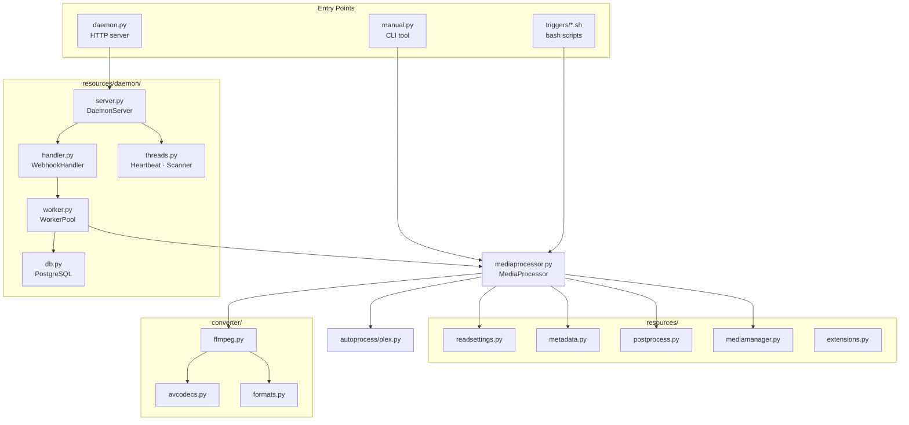
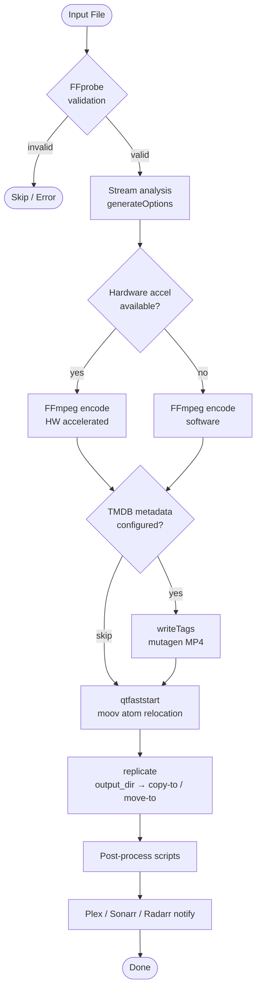

# Architecture

How the SMA-NG components fit together: entry points, the daemon package, the conversion pipeline and a module
reference. For the decision rules that drive stream selection see
[Configuration](configuration.md#video-decision-tree); for the daemon internals see [Daemon Mode](daemon.md).

## Components

A single-host install runs the components shown below. In **cluster mode**,
multiple nodes each run an identical daemon stack (server + worker pool +
heartbeat) sharing one PostgreSQL `jobs` / `cluster_nodes` / `node_commands`
table — see [Daemon Mode → Cluster Mode](daemon.md#cluster-mode) for the
internals and [Cluster Operations](cluster-operations.md) for the operator
runbooks (bootstrap, roll a config, zero-loss upgrade, drain a node,
recover from failure).

## Data Flow

---

## Module Reference

### converter/avcodecs.py

Codec definitions mapping SMA-NG names to FFmpeg encoders. Each codec class handles its own option parsing and FFmpeg
flag generation.

**Video codecs**: H264, H265, AV1, VP9, MPEG-1/2, H263, FLV, Theora + hardware variants (QSV, VAAPI, NVENC,
VideoToolbox, V4L2M2M, OMX)

**Audio codecs**: AAC, AC3, EAC3, DTS, FLAC, MP3, Vorbis, Opus, PCM variants, TrueHD, ALAC

**Subtitle codecs**: mov_text, SRT, SSA/ASS, WebVTT, PGS, DVDSub, DVBSub, copy

### converter/ffmpeg.py

FFmpeg/FFprobe wrapper. Key classes:

- **MediaInfo** / **MediaStreamInfo** / **MediaFormatInfo**: Parsed probe results. `MediaInfo.cover_art` lists
  artwork streams (attached pictures, cover art demoted to an `mp4v` video track, image attachments) and
  `is_unknown_stream()` flags streams FFprobe could not classify; both feed stream selection and the repair tool.
- **FFMpeg**: Binary wrapper with `probe(fname, posters_as_video=True, framedata=True)` (`framedata=False` skips the
  per-frame probe), `convert()`, `thumbnail()`, codec/hwaccel queries

### converter/formats.py

Container format definitions (MP4, MKV, AVI, WebM, etc.) mapping to FFmpeg muxer names.

### converter/\_\_init\_\_.py

**Converter** class: Orchestrates codec/format selection, builds FFmpeg commands, manages conversion with progress
tracking.

### resources/mediaprocessor.py

**MediaProcessor**: Core pipeline orchestrator. Key methods:

- `isValidSource()`: FFprobe validation
- `generateOptions()`: Stream analysis to FFmpeg option dict
- `convert()`: Execute FFmpeg; collision-safe (numbers outputs such as `name.2.mp4`, never overwrites), with a
  hardware-to-software fallback ladder whose last tier is a full-software re-encode (`fallback-policy: aggressive`)
- `fullprocess()`: Complete pipeline (validate, convert, tag, relocate, replicate, notify)
- `setAcceleration()`: Hardware accel configuration with bit-depth checks
- `estimateVideoBitrate()`: Source bitrate estimation
- `replicate()`: copy-to / move-to file operations

### resources/media_repair.py

**RepairProcessor**: stream-copy repair used by `repair.py`. `diagnose()` builds a `RepairPlan` (data, unknown, and
artwork streams to drop; corrective aspect ratio), `build_opts()` produces the `-c copy` options, and `verify()`
re-probes the copy before it atomically replaces the original.

### resources/library_audit/

Library auditor. `engine.py` (`AuditEngine`) probes one queue unit, upserts findings, and runs optional auto-fix, and
`run_audit_inline()` backs `manual.py --audit`. `probes.py` holds the per-file checks, including `repair_check()` for
`stream_damage` and `hybrid_aspect`. `enumerator.py`, `kinds.py`, and `recycler.py` walk roots, define finding kinds,
and move files to the recycle-bin. See [Library Audit](library-audit.md).

### resources/naming.py and resources/rename_util.py

`naming.py` is the template-based naming engine (data from Sonarr/Radarr, else FFprobe + guessit + TMDB).
`rename_util.py` backs `rename.py`: it renames already-converted files with those templates, updates `.plexmatch`
sidecars, and triggers a Plex refresh.

### resources/daemon/

- `server.py`: `DaemonServer`, the HTTP server and process lifecycle
- `handler.py`, `routes.py`: request handling and route tables (webhooks, jobs, logs, admin, library)
- `worker.py`: worker pool, job execution, and the timeout watchdog
- `threads.py`: heartbeat, scanner, and library-audit worker threads
- `db.py`: SQLite/PostgreSQL job store, cluster tables, and findings
- `config.py`: `daemon:` settings resolution (CLI flag, then `sma-ng.yml`, then default)

### resources/readsettings.py

**ReadSettings**: Parses `sma-ng.yml` (via `config_loader.py` and the pydantic schema in `config_schema.py`) into
typed attributes, applies profiles, and resolves service instances.

### resources/metadata.py

**Metadata**: TMDB API client + MP4 tagger (via mutagen). Resolves TMDB/TVDB/IMDB IDs, writes iTunes-compatible tags.

### resources/postprocess.py

**PostProcessor**: Discovers and runs the scripts in `post_process/` with the SMA-NG environment variables. See
[Post-Process Scripts](getting-started.md#post-process-scripts).

### resources/log.py

Logging setup with optional INI-based configuration. Core library output goes to stdout/stderr. The daemon writes
per-config rotating log files in `logs/`.

### resources/lang.py

Language code conversion (ISO 639 alpha2/alpha3) via babelfish.

### resources/custom.py

Optional hook points loaded from `config/custom.py` (an untracked operator file; copy `setup/custom.py.sample`, or let
the Docker entrypoint seed it): `validation()`, `blockVideoCopy()`, `blockAudioCopy()`,
`skipStream()`, `streamTitle()`.

### autoprocess/plex.py

Plex library refresh via PlexAPI with path mapping support.

### resources/mediamanager.py

Shared Sonarr/Radarr API helpers. After in-place conversion the daemon issues a two-step chain keyed on the
series/movie ID resolved via `/api/v3/parse`:

1. `RescanSeries` (Sonarr) / `RescanMovie` (Radarr) — re-evaluates known file records and unlinks the now-missing
   original path (extension and/or basename changed during conversion).
2. `DownloadedEpisodesScan` (Sonarr) / `DownloadedMoviesScan` (Radarr) with the converted *file* path and
   `importMode: Move` — imports the new file and links it to the existing series/movie. Without this second step the
   file is orphaned and the episode/movie shows as missing.

When the instance has `force-rename: true`, a `RenameFiles` command is chained after the import completes.
