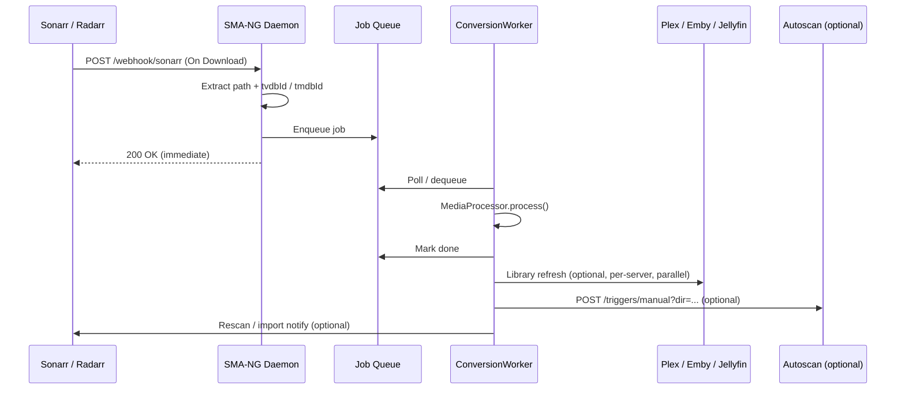

# Integrations

## Media Managers

### Sonarr

Two integration methods are available:

**Native webhook (recommended):** Sonarr posts directly to SMA-NG's built-in endpoint. No external script required.

1. In Sonarr: **Settings → Connect → Add Webhook**
   - On Download/Import: Yes, On Upgrade: Yes
   - URL: `http://<sma-host>:8585/webhook/sonarr`
   - Method: POST
   - If API key is configured, add header `X-API-Key: YOUR_SECRET_KEY`

SMA-NG reads `episodeFile.path`, `series.tvdbId` and the season and episode numbers from the Sonarr payload and
queues the job. When `tvdbId` is missing, it falls back to a `{tvdb-12345}` token in the file path, and then to
`series.imdbId`. Test events (the **Test** button) return `200 OK` without queuing anything. A path outside every
configured media root is rejected with `403`, and a path that does not exist with `400`.
Enable any other notification types (On Rename, On Episode File Delete, On Series Delete, ...) to have SMA-NG
forward them to Autoscan. See [Forwarding other Sonarr/Radarr events](#forwarding-other-sonarrradarr-events).

**Choose a profile with a tag.** Tag a series in Sonarr with `sma-profile-<name>` (for example `sma-profile-lq`) to
convert its files with the profile `<name>` instead of the profile that the routing rule selects. Radarr movies
work the same way.

**Custom script:** Suitable when Sonarr cannot reach the daemon over HTTP but can run a script on the same host
as SMA-NG. The script builds the same payload from Sonarr's environment variables, posts it to
`/webhook/sonarr`, and waits until the job finishes.

1. In Sonarr: **Settings → Connect → Add Custom Script**
   - On Download/Import: Yes, On Upgrade: Yes
   - Path: `/bin/bash`
   - Arguments: full path to `triggers/media_managers/sonarr.sh`
2. Export `DAEMON_HOST`, `DAEMON_PORT` and `DAEMON_API_KEY` (or `DAEMON_USERNAME` and `DAEMON_PASSWORD`) for the
   script if the daemon is not on `127.0.0.1:8585` or requires authentication. `POLL_INTERVAL` (default 5
   seconds) and `TIMEOUT` (default 0, no limit) control the wait for the job.

**Instance settings.** The `services.sonarr.<name>` block tells SMA-NG how to reach Sonarr after a conversion:

| Key | Default | Purpose |
| --- | --- | --- |
| `url` | required | Base URL, including any URL base such as `http://host:8989/sonarr` |
| `apikey` | empty | Sonarr API key; an instance without one is never used |
| `rescan` | `true` | Ask Sonarr to rescan and import the converted file (see below) |
| `force-rename` | `false` | After the import, run Sonarr's own `RenameFiles` command |

The full key reference is in [Configuration](configuration.md).

**What happens after a conversion.** When the output file lies under a routed path of a Sonarr or Radarr instance
and `rescan` is on, `manual.py` (and therefore every daemon job) does the following:

1. Run `RescanSeries` (Sonarr) or `RescanMovie` (Radarr) and wait for it to finish.
2. Run `DownloadedEpisodesScan` or `DownloadedMoviesScan` for the converted file with `importMode: Move`, so
   Sonarr or Radarr links the new file instead of leaving it orphaned.
3. If `force-rename` is on, run `RenameFiles` once the import has completed.

If the rescan does not finish within five minutes or ends in a failed state, SMA-NG logs a warning and imports
anyway. Skipping the import would leave the file unlinked, and Sonarr or Radarr would then grab the release again.
If the import itself does not finish, the `RenameFiles` step is skipped.

**Per-instance profile routing:** Add `daemon.routing` rules to `sma-ng.yml`. Each rule has a `match` path prefix,
an optional `profile`, and a `services` list of instances to notify after conversion. This is useful when Sonarr
imports to a path that should use a specific profile:

```yaml
services:
  sonarr:
    main:
      url: http://sonarr.example.com:8989
      apikey: YOUR_SONARR_KEY

daemon:
  routing:
    - match: /mnt/unionfs/Media/TV
      profile: rq
      services: [sonarr.main]
```

**Path rewrites:** When Sonarr reports paths that differ from what SMA-NG sees (for example Sonarr in a container),
translate them with `daemon.path-rewrites` before routing:

```yaml
daemon:
  path-rewrites:
    - from: /tv
      to: /mnt/unionfs/Media/TV
```

### Radarr

Two integration methods are available:

**Native webhook (recommended):** Radarr posts directly to SMA-NG's built-in endpoint.

1. In Radarr: **Settings → Connect → Add Webhook**
   - On Download/Import: Yes, On Upgrade: Yes
   - URL: `http://<sma-host>:8585/webhook/radarr`
   - Method: POST
   - If API key is configured, add header `X-API-Key: YOUR_SECRET_KEY`

SMA-NG reads `movieFile.path` and `movie.tmdbId` and queues the job. When `tmdbId` is missing, it falls back to a
`{tmdb-12345}` token in the file path, and then to `movie.imdbId`. Test events return `200 OK` without queuing.
Other notification types (On Rename, On Movie File Delete, On Movie Delete, ...) are forwarded to Autoscan. See
[Forwarding other Sonarr/Radarr events](#forwarding-other-sonarrradarr-events).

**Custom script:** Suitable when Radarr can run a script on the same host as SMA-NG. It works like the Sonarr
script, including the `DAEMON_*` variables.

1. In Radarr: **Settings → Connect → Add Custom Script**
   - On Download/Import: Yes, On Upgrade: Yes
   - Path: `/bin/bash`
   - Arguments: full path to `triggers/media_managers/radarr.sh`

The `services.radarr.<name>` block takes the same keys as the Sonarr block above. The post-conversion rescan and
import use `RescanMovie` and `DownloadedMoviesScan`.

**Per-instance routing:** Same as Sonarr; choose instances and profiles with `daemon.routing` rules and translate
paths with `daemon.path-rewrites` in `sma-ng.yml`.

### Multiple Instances

Sonarr and Radarr each support arbitrary named instances under `services.sonarr.<name>` / `services.radarr.<name>` in `sma-ng.yml`. The instance used for a given file is decided by `daemon.routing` rules — the longest matching `match` prefix wins.

```yaml
services:
  sonarr:
    main:
      url: http://sonarr.example.com:8989
      apikey: abc123
    kids:
      url: http://sonarr-kids.example.com:8989
      apikey: def456
  radarr:
    main:
      url: http://radarr.example.com:7878
      apikey: ghi789
    4k:
      url: http://radarr-4k.example.com:7878
      apikey: jkl012

daemon:
  routing:
    - match: /mnt/unionfs/Media/TV
      profile: rq
      services: [sonarr.main]
    - match: /mnt/unionfs/Media/TV-Kids
      profile: lq
      services: [sonarr.kids]
    - match: /mnt/unionfs/Media/Movies
      profile: rq
      services: [radarr.main]
    - match: /mnt/unionfs/Media/Movies/4K
      profile: rq
      services: [radarr.4k]
```

When a conversion finishes for `/mnt/unionfs/Media/Movies/4K/film.mkv`, the matcher picks the
`/mnt/unionfs/Media/Movies/4K` rule (longest prefix) and triggers the rescan on `radarr.4k`.

The deploy tooling stamps these rules automatically: list each instance with `path` + `profile` under `services.sonarr` / `services.radarr` in `setup/local.yml` and `mise run deploy:config` rebuilds `daemon.routing` longest-prefix-first on every roll. See [Deployment](deployment.md).

### Plex

Configure `services.plex.<name>` in `sma-ng.yml`. After each conversion, SMA-NG connects to every Plex instance
with `refresh: true` and refreshes the library sections whose folders contain the converted file's directory. Use
the instance's `path-mapping` if Plex sees the files at different mount points.

1. Disable automatic library scanning in Plex, so that Plex does not scan files in the middle of a conversion.
2. Connect directly to the Plex server by its local hostname or IP on port `32400` (or your custom port), and set
   `url`, `token` and `refresh: true` on the `services.plex.<name>` instance:

```yaml
services:
  plex:
    main:
      url: http://plex.local:32400
      token: YOUR_PLEX_TOKEN
      refresh: true
      path-mapping: ''   # from=to[,from=to] when Plex sees different mount points
      ignore-certs: false
      plexmatch: true    # write .plexmatch files during rename.py runs
```

A Plex instance that cannot be reached, or whose token is wrong, logs a warning and never fails the conversion.

#### Optimized versions for 4K content

`scripts/plex-optimize-4k.py` queues Plex Media Optimizer jobs for every 4K
movie/episode that doesn't already have an optimized version, defaulting to
the `Universal TV` profile at 8 Mbps 1080p. Plex writes the result next to
the original under `Plex Versions/` (a directory the library audit skips by
default; see [Library Audit](library-audit.md)).

```bash
PLEX_URL=http://plex.local:32400 PLEX_TOKEN=xxx \
  python scripts/plex-optimize-4k.py --dry-run          # preview
python scripts/plex-optimize-4k.py --libraries Movies   # movies only
python scripts/plex-optimize-4k.py --quality 10mbps-1080p --limit 20
```

The script follows JBOPS `media_manager.py` conventions (`PLEX_URL` /
`PLEX_TOKEN`, `--libraries`) but calls python-plexapi's `optimize()`
directly, because the JBOPS `--action optimize` path is an unimplemented
stub and its selectors cannot filter by resolution. Transcoding is done by
Plex itself, not SMA-NG; re-running is idempotent.

### Emby

Configure one or more `services.emby.<name>` instances in `sma-ng.yml`. After
each successful conversion SMA-NG POSTs `/Library/Media/Updated` to every
matching Emby server with the converted file's parent directory, scoping the
metadata refresh rather than triggering a full-library rescan.

```yaml
services:
  emby:
    main:
      url: http://emby.local:8096
      apikey: ''        # Settings → Advanced → API Keys
      refresh: true
      path-mapping: ''  # k=v[,k=v] — same syntax as plex.path-mapping
      ignore-certs: false
      enabled: true
```

Reference the instance from a `daemon.routing[].services` rule to gate which
converted files trigger which servers (per-path-tree routing, longest-prefix
match, identical to Sonarr/Radarr/Autoscan):

```yaml
daemon:
  routing:
    - match: /mnt/unionfs/Media/Movies
      profile: rq
      services: [radarr.main, emby.main]
```

Authentication uses the per-instance `apikey` via the `X-Emby-Token` header.
Per-instance failures are logged and swallowed so a transient Emby outage never
fails the conversion job.

When a conversion replaces the original with a different file (for example `.mkv` to `.mp4` with the original
deleted), SMA-NG also reports the old path as `Deleted`, so the server drops the stale library entry.

**Path mapping** rewrites the directory sent to Emby when SMA-NG and Emby see
different mount points. Same `from=to[,from=to]` syntax as `plex.path-mapping`.

### Jellyfin

Configure one or more `services.jellyfin.<name>` instances in `sma-ng.yml`.
Jellyfin retained Emby's `/Library/Media/Updated` endpoint after the fork, so
the integration shape is identical:

```yaml
services:
  jellyfin:
    main:
      url: http://jellyfin.local:8096
      apikey: ''        # Dashboard → API Keys
      refresh: true
      path-mapping: ''
      ignore-certs: false
      enabled: true
```

Routing-rule gating, auth header, path-mapping, and failure semantics are
identical to the Emby integration above. Both can be referenced from the same
routing rule when one converted file should refresh both servers.

### Emby / Jellyfin troubleshooting

| Symptom | Likely cause |
| ------------------------------- | --------------------------------------------------------------------------------------------------------------------------------- |
| 401 returned | Wrong `apikey`, or apikey not granted access in admin |
| 404 returned | The server runs under a URL base; include it in `url` (for example `http://host:8096/emby`) |
| No POST issued | The file's directory is not under any `daemon.routing[].match` that lists `emby.<name>` / `jellyfin.<name>`, or `refresh` is `false`, or `enabled` is `false` |
| Library not updated despite 204 | Path mismatch: the server does not recognise the directory; add a `path-mapping` entry |
| `skipped: no apikey configured` warning | The `apikey` field of the instance is empty |

### Autoscan

[Autoscan](https://github.com/Cloudbox/autoscan) is a notification fan-out service
that translates a single trigger into targeted scans across Plex / Emby / Jellyfin.
Use it when one converted file should land in multiple library backends, or when
you want to delegate scan throttling and retry logic to Autoscan instead of
calling each library directly.

Configure one or more instances under `services.autoscan.<name>`:

```yaml
services:
  autoscan:
    main:
      url: http://autoscan.local:3030
      username: ''       # optional HTTP Basic Auth
      password: ''
      path-mapping: ''   # k=v[,k=v] — same syntax as plex.path-mapping
      ignore-certs: false
      enabled: true
      sonarr-trigger: sonarr   # Autoscan trigger name for forwarded Sonarr events
      radarr-trigger: radarr   # Autoscan trigger name for forwarded Radarr events
```

Each instance is gated by the same `daemon.routing[].services` mechanism used by
Sonarr/Radarr. Reference an instance from a routing rule to control which
converted files trigger it:

```yaml
daemon:
  routing:
    - match: /mnt/unionfs/Media/TV
      profile: rq
      services: [sonarr.main, autoscan.main]
    - match: /mnt/unionfs/Media/Movies
      profile: rq
      services: [radarr.main, autoscan.main]
```

**Deploy fan-out.** Under `mise run deploy:config`, an Autoscan instance in
`setup/local.yml` that has no `path:` or `profile:` is treated as a fan-out
target — its ref is appended to every routing rule generated from
sonarr/radarr instances. So a single global Autoscan block:

```yaml
services:
  autoscan:
    main:
      url: http://autoscan.local:3030
      username: ''
      password: ''
```

attaches to every per-path rule on roll, with no per-path duplication.

After a successful conversion (file back at its final source-dir location),
SMA-NG POSTs `/triggers/manual?dir=<directory>` to every matching Autoscan
instance. Per-instance failures are logged and swallowed so a transient
Autoscan outage never fails the conversion job.

**Path mapping** rewrites the `dir` value when SMA-NG and Autoscan see different
mount points (e.g. `/library/Media` here, `/data/Media` there). Use the same
`from=to[,from=to]` syntax as `plex.path-mapping`.

#### Forwarding other Sonarr/Radarr events

`/webhook/sonarr` and `/webhook/radarr` only transcode `Download` (import/upgrade) events. Every other event type —
`Grab`, `Rename`, `EpisodeFileDelete`, `SeriesDelete`, `MovieFileDelete`, `MovieDelete`, `Health`,
`ApplicationUpdate`, and so on — is passed through unchanged to Autoscan's native trigger
(`/triggers/<sonarr-trigger>` or `/triggers/<radarr-trigger>`), so SMA-NG can sit in front of Autoscan as the only webhook target.

- **Target selection.** SMA-NG collects every path in the payload (series/movie folder, `episodeFile`/`movieFile`,
  `deletedFiles`, `renamed*Files`), applies `daemon.path-rewrites`, and forwards to each `autoscan.<name>`
  referenced by a matching routing rule. Payloads with no paths (Health, ApplicationUpdate) go to every enabled
  Autoscan instance.
- **Path mapping.** The payload is not rewritten; SMA-NG's `path-mapping` only applies to post-conversion
  `/triggers/manual` calls. Use Autoscan's own `rewrite` rules on its `sonarr` / `radarr` triggers instead.
- **Responses.** `200` with `status: forwarded` and per-instance results, `200` with `status: ignored` when no
  Autoscan instance matches, or `502` when every forward attempt failed, so the failure shows up in the
  Sonarr/Radarr connection health check.
- **Autoscan setup.** Autoscan must define `sonarr` / `radarr` triggers. Set `sonarr-trigger` / `radarr-trigger`
  on the `services.autoscan.<name>` instance when they are named differently (e.g. `sonarr-1080p`).

`Download` events are not forwarded: SMA-NG triggers Autoscan itself (`/triggers/manual`) after the converted file
is back in place.

#### Autoscan troubleshooting

| Symptom | Likely cause |
| ----------------- | -------------------------------------------------------------------------------------------- |
| 401 returned | Wrong `username` / `password`, or Autoscan instance has no auth configured |
| 404 returned | Autoscan runs under a URL base; include it in `url` |
| No POST issued | File's directory isn't a prefix of any `daemon.routing[].match` that lists `autoscan.<name>` |
| Wrong `dir` sent | Add a `path-mapping` entry rewriting SMA's path to Autoscan's |
| `status: ignored` | Forwarded event's paths don't match any routing rule listing `autoscan.<name>` |
| 502 from webhook | Every forward failed; check `sonarr-trigger`/`radarr-trigger` match Autoscan's trigger names |

### Integration Flow

The following sequence applies to both Sonarr and Radarr using the native webhook method:



### Path matching and request timeouts

- Instance routing (each Sonarr, Radarr, Emby, Jellyfin and Autoscan instance takes its paths from the
  `daemon.routing` rules whose `services` reference it) matches on whole path components: `/media/TV` matches
  `/media/TV` and `/media/TV/Show`, but not `/media/TV-Anime`. Plex refreshes compare the file's directory with
  the library section folders in the same way.
- Sonarr/Radarr API calls time out after 30 seconds (`REQUEST_TIMEOUT` in `resources/mediamanager.py`).
- After a conversion the post-convert `RescanSeries` / `RescanMovie` resolves the series or movie by the TVDB id
  (Sonarr) or TMDB id (Radarr) the trigger passed, then by the arr title parser on the basename, then by the
  series/movie whose library `path` contains the file. The id and path lookups cover titles the parser misreads,
  such as `Blade Runner 2099 (2026) - S01E01`, which Sonarr parses as "Blade Runner" with year 2099.
- `rename.py --arr-rename` finds the Sonarr/Radarr file record by exact path, then by the path rewritten through
  the instance `path-mapping`, then by a unique basename. Radarr `RenameFiles` is sent with `movieId` and `files`.
- Plex refreshes do not use routing rules. They go to every instance with `refresh: true`, and each refresh
  covers the library sections whose folders contain the converted file.

### rename.py behaviour

`rename.py` renames media files with the `base.naming` templates, or with Sonarr and Radarr's own naming when you
pass `--arr-rename`. Use `--dry-run` to preview. Other options are `--movie`/`--tv`, `--tmdb`/`--tvdb`/`--imdb`,
`-s`/`-e`, `--no-plexmatch`, `--no-plex`, `-c PATH` and `-v`; `python rename.py -h` lists them all.

- The release source tag (for example `BluRay`, `WEB-DL`, `Remux`) and the video codec token of the release name
  are kept in the new name. A stream-copied `x265` release therefore stays `x265` instead of becoming `HEVC`.
- A title that already ends in the release year is not given the year twice: `Movie (2020)` with year 2020 stays
  `Movie (2020)`. A year that differs from the known year is kept, because it may tell two series apart.
- `.plexmatch` files are written from the metadata resolved during the rename (skipped when only a media type could
  be guessed, or with `--arr-rename`).
- With path-based config routing, `.plexmatch` writing and Plex refreshes use each file's own routed settings.
  The Plex refresh honours every `services.plex.<name>` instance with `refresh: true`.
- Renames never overwrite an existing file. Subtitle sidecars (`.srt`, `.ass`, `.vtt`, `.sub`, `.idx`, with optional
  language suffixes such as `.en.forced`) are renamed alongside the media file.

---

## Download Clients

All download client integrations use bash scripts in `triggers/` that submit jobs to the daemon via
`POST /webhook/generic`. They are not required if you are using Completed Download Handling with Sonarr/Radarr.

The scripts read no `sma-ng.yml` sections. They take daemon connection settings from environment variables
(set them in the download client's script environment):

| Variable | Default | Description |
| ---------------------------------- | ----------- | --------------------------------------------- |
| `DAEMON_HOST` | `127.0.0.1` | Daemon hostname or IP |
| `DAEMON_PORT` | `8585` | Daemon port |
| `DAEMON_API_KEY` | none | Sent as `X-API-Key` when authentication is on |
| `DAEMON_USERNAME` / `DAEMON_PASSWORD` | none | HTTP Basic auth alternative to the API key |

Which profile a download uses is decided on the daemon by `daemon.routing` rules matching the file path (see
[Multiple Instances](#multiple-instances)); translate client-side paths with `daemon.path-rewrites`. Per-script
options such as `BYPASS_CATS` / `BYPASS_LABELS` are documented in [triggers/README.md](../triggers/README.md).
`setup/post_process/*_post_process.sh` are alternative standalone submitters that POST `{path, args}` to
`/webhook/generic` and use the same `DAEMON_*` variables.

To submit files by hand, use `triggers/cli/scan.sh` (add `--wait` to block until the job ends) or
`sma-webhook.sh submit <path>`. Both accept a file or a directory.

### Trigger script behaviour

The download-client scripts submit only media files (`mkv mp4 m4v avi mov wmv ts m2ts mpg mpeg flv webm`; override
with the space-separated `SMA_MEDIA_EXTS` environment variable). They exit non-zero when a submission fails or when
no media file was submitted: NZBGet exits `94` (error) for failed submissions and `95` (nothing to do) when no media
was found; SABnzbd, qBittorrent, Deluge and uTorrent exit `1`. Daemon requests use a 10 second connect timeout and
a 60 second overall timeout. `triggers/media_managers/sonarr.sh` and `radarr.sh` keep the daemon response in a
per-invocation temporary file, so concurrent imports do not overwrite each other.

`sma-webhook.sh` exits non-zero on HTTP errors and applies `SMA_CONNECT_TIMEOUT` (default 5) and `SMA_MAX_TIME`
(default 30) seconds to every request.

### NZBGet

In **Settings → Extension Scripts**, add `triggers/usenet/nzbget.sh`. Configure categories under the script settings.

### SABnzbd

In **Settings → Folders → Scripts Folder**, point to `triggers/usenet/`. Set `sabnzbd.sh` as the category script. Set the `DAEMON_*` variables in SABnzbd's environment.

### qBittorrent

In **Tools → Options → Downloads → Run external program on torrent completion**:

```bash
bash /path/to/triggers/torrents/qbittorrent.sh "%L" "%T" "%R" "%F" "%N" "%I"
```

Set the `DAEMON_*` variables for the qBittorrent process; skip labels with `BYPASS_LABELS`.

### Deluge

Enable the **Execute** plugin in Deluge WebUI. Set `triggers/torrents/deluge.sh` as the Torrent Complete handler. Set the `DAEMON_*` variables for the Deluge process; skip labels with `BYPASS_LABELS`.

### uTorrent

In **Options → Preferences → Advanced → Run Program**:

```bash
bash /path/to/triggers/torrents/utorrent.sh %L %T %D %K %F %I %N
```
