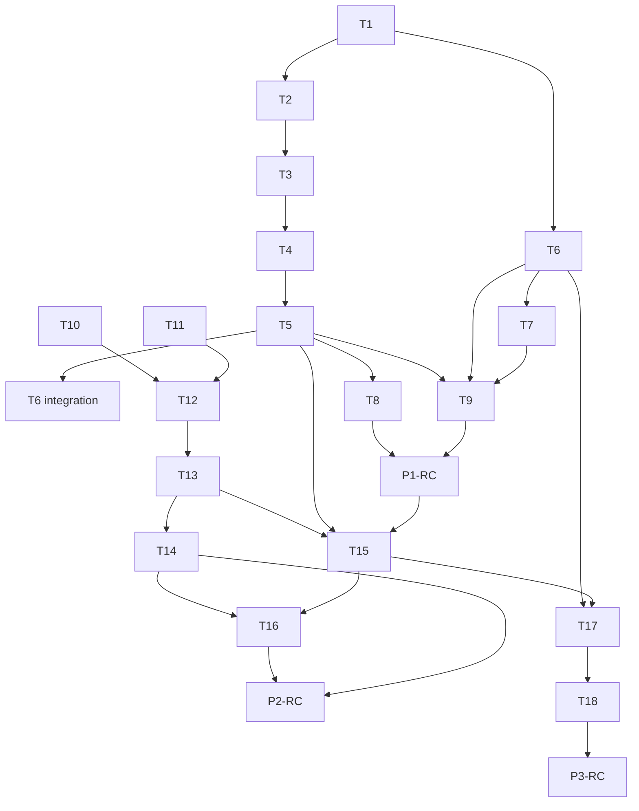

# Tasks: sma CLI as a Container Runtime and Daemon Client

STATUS: IN-FLIGHT

Source PRP: [sma-cli-container-runtime](../prps/sma-cli-container-runtime.md)

**Feature**: A single `sma` command (POSIX bootstrap plus Python client in the image) that runs tools in throwaway
containers, submits jobs to local or remote daemons over HTTP, and manages the daemon lifecycle.

**Sizing**: S = under half a day, M = about one day, L = two or more days.

**Conventions for every task**:

- Python uses 2-space indentation, single-line log records, and no `print()` in `resources/daemon/`.
- `resources/cli/` may write to stdout/stderr but never prints or logs API keys.
- Shell is POSIX and ShellCheck clean, with no inline Python and no `eval`.
- Each task's tests live in the same commit as its behaviour.
- Activate the venv first: `source venv/bin/activate`.

## Dependency Graph

**Critical path**: T1 -> T2 -> T3 -> T4 -> T5 -> T9 -> P1-RC -> T10 -> T12 -> T13 -> T15 -> T16 -> P2-RC ->
T17 -> T18 -> P3-RC (T10/T11 can start earlier; T6 is the long shell side branch that must land before T9).

**Parallel work**:

- Phase 1: T1 (plan model) and T6 (bootstrap shell, built against the protocol text) run in parallel. T2 -> T3 -> T4
  is a serial Python chain. T7 follows T6. T8 follows T5.
- Phase 2: T10 and T11 are independent and can start during Phase 1 (daemon side has no client dependency). T15 can
  start against the documented API shapes once T13 has stabilised the route contract. T14 runs alongside T15.
- Phase 3: T17 needs T6 (plan protocol) and T15 (client config, HTTP); T18 follows T17.

---

## Phase 1: Throwaway runtime

Deliverable: `curl | sh` installs `sma`; `sma repair|convert|audit|preview|rename|codecs|shell` run in a throwaway
container. No daemon features.

### P1-T1: Plan model and serializer

- **Goal**: Ordered Step/Plan model emitting protocol v1 text (`sma-plan 1` / `step` / `arg` / `optmount` / `end`).
- **Files**: `resources/cli/plan.py`, `tests/test_cli_plan.py`
- **Dependencies**: none
- **Size**: S
- **Acceptance criteria**:
  - [ ] Given a Plan with args and optmount items, when serialized, then items keep their order and the output
    starts with `sma-plan 1`.
  - [ ] Given args with spaces, quotes, globs or a leading dash, when serialized, then each is preserved verbatim
    on its own `arg` line.
  - [ ] Given a value containing `\n` or `\0`, when added, then `PlanError` is raised (maps to exit 5).
  - [ ] Given a step whose subcommand is not allow-listed (`run pull rm stop logs compose exec create cp inspect`),
    when built, then `PlanError` is raised.
- **Validation**: `python -m pytest tests/test_cli_plan.py -q`

### P1-T2: Host facts parsing

- **Goal**: Parse `SMA_HOST_*` env, `/plan/argstat` and optional `/plan/daemon.json` into `HostFacts`.
- **Files**: `resources/cli/hostfacts.py`, `tests/test_cli_hostfacts.py`
- **Dependencies**: P1-T1 (PlanError)
- **Size**: S
- **Acceptance criteria**:
  - [ ] Given a complete env and an argstat file of `<index>\t<d|f|->\t<abspath>` lines, when parsed, then
    `HostFacts` carries typed `ArgStat` entries, `dri_gids` as ints and booleans for tty/nvidia/rootless/selinux.
  - [ ] Given a missing or malformed variable, when parsed, then `PlanError` names that variable.
  - [ ] Given no `daemon.json`, when parsed, then `daemon_container` is `None`; given one, it is the first inspect
    object.
- **Validation**: `python -m pytest tests/test_cli_hostfacts.py -q`

### P1-T3: Mount set computation

- **Goal**: Required mounts from path args, optional mounts from config-derived dirs, `--mount` and extra-mounts.
- **Files**: `resources/cli/mounts.py`, `tests/test_cli_mounts.py`
- **Dependencies**: P1-T2
- **Size**: M
- **Acceptance criteria**:
  - [ ] Given argstat kind `d`, `f` and `-`, when computing required mounts, then `d` mounts the directory, `f`
    mounts its parent, and `-` raises UsageError (exit 2) `sma: <arg>: no such file or directory`.
  - [ ] Given `/` or a path containing `:`, when computing mounts, then it is refused with exit 2.
  - [ ] Given a config with `output-directory`, `move-to`, `copy-to`, `recycle-bin` and analyzer dirs, when
    collected, then each absolute path becomes an optional mount (the `optmount` line); a `ConfigError` gives exit 2
    with the message.
  - [ ] Given duplicate and nested paths, when deduped, then exact duplicates and paths nested under another are
    dropped and required wins over optional.
  - [ ] Given a new path-like `ConverterConfig` field name (dir/directory/path/move/copy/recycle), when the guard
    test runs, then it fails until the field is in the collector or an explicit ignore list.
- **Validation**: `python -m pytest tests/test_cli_mounts.py -q`

### P1-T4: Throwaway container plan builder

- **Goal**: `build_plan(command, tool_args, facts, cfg)` producing the `docker run` step(s) per command.
- **Files**: `resources/cli/throwaway.py`, `tests/test_cli_throwaway.py`
- **Dependencies**: P1-T1, P1-T2, P1-T3
- **Size**: L
- **Acceptance criteria**:
  - [ ] Given `repair /a` with uid 1000, when planned, then the final step is `run --rm --label sma.throwaway=1
    -w /app --user 1000:1000 -e HOME=/tmp ... -v /a:/a IMAGE run python repair.py /a` and no `-c` is passed.
  - [ ] Given rootless Docker or uid 0, when planned, then `--user` is omitted; given SELinux, then required mounts
    carry `:z`.
  - [ ] Given DRI gids `44,993` and NVIDIA, when planned, then `--device /dev/dri`, `--group-add 44`,
    `--group-add 993` and `--gpus all` appear.
  - [ ] Given logs not writable, when planned, then `--tmpfs /app/logs` replaces the logs bind mount; the config
    dir is mounted at `/app/config:ro`.
  - [ ] Given `convert A B`, when planned, then there is one docker step per path with the last exec'd; `-t` is
    present only when `facts.tty`.
- **Validation**: `python -m pytest tests/test_cli_throwaway.py -q`

### P1-T5: Command surface and entry point

- **Goal**: argparse surface (Phase 1 subset), exit-code mapping, `python -m resources.cli`.
- **Files**: `resources/cli/commands.py`, `resources/cli/__init__.py`, `resources/cli/__main__.py`,
  `tests/test_cli_commands.py`
- **Dependencies**: P1-T4
- **Size**: M
- **Acceptance criteria**:
  - [ ] Given `convert preview repair audit rename codecs shell version help` with `--local`, `--mount`, `-q`, when
    parsed, then each dispatches to the matching plan builder and writes `/plan/plan`.
  - [ ] Given a Phase 2 or 3 command, when run, then it exits 2 with `not available in this version`.
  - [ ] Given UsageError, Unreachable, AuthError and PlanError, when raised, then exit codes are 2, 3, 4 and 5.
  - [ ] Given `sma version`, when run, then it prints the client version and exits 0.
- **Validation**: `python -m pytest tests/test_cli_commands.py -q`

### P1-T6: Bootstrap shell script

- **Goal**: Rewrite `setup/sma-host.sh` as the bootstrap: collect host facts, write argstat, run the client
  container, execute the plan without `eval`, and implement `sma upgrade`.
- **Files**: `setup/sma-host.sh`, `tests/test_sma_host.py` (extend the fake-docker harness)
- **Dependencies**: P1-T1 (protocol); integration assertions need P1-T5
- **Size**: L
- **Acceptance criteria**:
  - [ ] Given arguments with spaces, `$()`, `;` and `*`, when run, then argstat and the executed docker argv carry
    them verbatim (no eval) and the plan dir is removed before steps run.
  - [ ] Given a plan whose first line is not `sma-plan 1`, when read, then it exits 5 with
    `plan version X unsupported; run sma upgrade`.
  - [ ] Given `optmount /x` lines, when `/x` exists then `-v /x:/x` (plus `:z` under SELinux) is added, and when
    absent then nothing is added.
  - [ ] Given multi-step plans, when run, then steps run in order, a non-zero step aborts with its code, and the
    last step is `exec`'d; a non-allow-listed docker subcommand is refused.
  - [ ] Given `sma upgrade [TAG]`, when run, then it pulls the image, copies the bootstrap out via create/cp/rm,
    replaces `$0` (non-writable gives a `sudo sma upgrade` hint and exit 2) and rewrites `~/.config/sma/image`.
- **Validation**: `python -m pytest tests/test_sma_host.py -q`; `mise run test:shell`

### P1-T7: CLI-first installer

- **Goal**: Rewrite `install-smang.sh` (untracked draft) to install the CLI with only Docker present.
- **Files**: `install-smang.sh`, `tests/test_install_smang.py`
- **Dependencies**: P1-T6
- **Size**: M
- **Acceptance criteria**:
  - [ ] Given Docker is missing or `docker info` fails, when run, then it exits non-zero with a one-line reason.
  - [ ] Given arm64, when no tag is given, then it resolves the latest release tag via the GitHub API; `--tag` or
    `SMA_IMAGE_TAG` overrides on any arch.
  - [ ] Given a fresh host, when run (also piped as `sh -s --`), then it pulls the image, installs `sma` to
    `/usr/local/bin` (or `~/.local/bin` with a PATH warning), writes `~/.config/sma/image` for the invoking user
    and seeds `$SMA_HOME/{config,logs,data}` plus a sample `sma-ng.yml` only if missing.
  - [ ] Given a second run, when repeated, then it is idempotent and does not overwrite existing config.
  - [ ] Given `--daemon`, when run before Phase 3, then it prints that daemon setup is not yet available.
- **Validation**: `python -m pytest tests/test_install_smang.py -q`; `mise run test:shell`

### P1-T8: Image smoke coverage

- **Goal**: Confirm `resources/cli` ships in the image and is exercised by the smoke test.
- **Files**: `.mise/tasks/build/smoke`, `scripts/docker_smoke_imports.py`, `docker/Dockerfile` (only if needed)
- **Dependencies**: P1-T5
- **Size**: S
- **Acceptance criteria**:
  - [ ] Given the built image, when the smoke task runs, then `python -m resources.cli version` exits 0.
  - [ ] Given `scripts/docker_smoke_imports.py`, when run, then it imports `resources.cli` successfully.
  - [ ] Given the Dockerfile, when inspected, then no change is made unless `COPY . .` fails to include the package.
- **Validation**: `mise run build:smoke` (ask the operator before running containers); `mise run test:shell`

### P1-T9: Phase 1 documentation

- **Goal**: Operator docs for the install, throwaway model, mounts, GPU, exit codes, upgrade and troubleshooting.
- **Files**: `docs/sma-cli-quickstart.md`, `docs/docker-compose-quickstart.md`, `README.md`, `docs/deployment.md`
- **Dependencies**: P1-T5, P1-T6, P1-T7 (docs land in those commits)
- **Size**: M
- **Acceptance criteria**:
  - [ ] Given the quickstart, when read, then it documents the curl install, throwaway runs, mount rules, GPU
    flags, exit codes 0-5 and 130, `sma upgrade` and troubleshooting.
  - [ ] Given the compose quickstart and README, when read, then install steps point to `install-smang.sh`.
  - [ ] Given the docs, when searched, then no identity-mount wording remains for throwaway runs.
  - [ ] Given `mise run docs:check`, when run, then it passes with markdownlint clean at 120 columns.
- **Validation**: `mise run docs:check`

### P1-RC: Phase 1 release checkpoint

- **Goal**: Phase 1 is releasable on its own (throwaway runtime, no daemon features).
- **Dependencies**: P1-T1 through P1-T9
- **Size**: S
- **Acceptance criteria**:
  - [ ] Given all Phase 1 changes, when the suite runs, then `ruff check`, `mise run test:lint`,
    `mise run test:shell`, `python -m pytest tests/test_cli_*.py tests/test_sma_host.py
    tests/test_install_smang.py -q` and `python -m pytest tests/test_docker.py tests/test_entrypoint.py -q` pass.
  - [ ] Given coverage, when `mise run test:cov` runs, then global >= 90% and every module with >= 100 statements
    is >= 70%.
  - [ ] Given docs, when `mise run docs:check` runs, then it passes; docs were updated in the same commits as the
    behaviour.
  - [ ] Given the commit history, when reviewed, then commits are conventional and split by behaviour (for example
    `feat(cli): plan protocol and client`, `feat(sma-host): bootstrap`, `feat(install): CLI-first installer`),
    each with its tests and docs, no AI attribution.
  - [ ] Given a pushed docs change, when `git push` of `main` completes, then `mise run wiki:publish` has run.
- **Validation**: `mise run test:cov`; `mise run docs:check`; `mise run test`

---

## Phase 2: Daemon targets

Deliverable: daemon job kinds and endpoints; client submits over HTTP to local or remote targets with mappings, auth,
progress, `--json` and `sma jobs`.

### P2-T10: Job kind registry

- **Goal**: `JobKind` registry with per-kind argv builder, success codes, directory rules and forbidden args.
- **Files**: `resources/daemon/job_kinds.py`, `tests/test_job_kinds.py`
- **Dependencies**: none (can start during Phase 1)
- **Size**: S
- **Acceptance criteria**:
  - [ ] Given each kind (convert, repair, preview, audit, rename), when `argv()` is called, then it returns the
    PRP argv; convert is byte-identical to today's worker argv and repair/rename pass no `-c`.
  - [ ] Given audit, when rc is 1, then it is in `success_codes`; for the others only 0 is.
  - [ ] Given args containing `-c`, `--config`, `-i`, `--input` or `--job-id`, when validated, then they are
    rejected.
- **Validation**: `python -m pytest tests/test_job_kinds.py -q`

### P2-T11: Database changes (both backends)

- **Goal**: `kind`, `output`, `output_dropped` on jobs and `capabilities` on cluster_nodes, with kind-aware queue
  methods and a 1 MiB output tail cap.
- **Files**: `resources/daemon/db.py`, `tests/test_sqlite_db.py`, `tests/test_daemon.py`
- **Dependencies**: none (can start during Phase 1)
- **Size**: L
- **Acceptance criteria**:
  - [ ] Given a legacy database, when the daemon starts twice, then the new columns are added once (SQLite
    PRAGMA-guarded; PostgreSQL `ADD COLUMN IF NOT EXISTS`, asserted on the mocked SQL) and
    `_METRICS_EXPANSION_COLUMNS` is untouched.
  - [ ] Given the same path with two kinds, when `add_job` runs, then both are accepted; the same path and kind is
    a duplicate (`find_active_job` filters on kind).
  - [ ] Given `claim_next_job(kinds=[...])`, when jobs of other kinds are queued, then they are not claimed.
  - [ ] Given output beyond 1 MiB, when `append_job_output` runs, then only the tail is kept and `output_dropped`
    counts the dropped bytes; `cleanup_old_jobs` purges output with the row.
  - [ ] Given `heartbeat(capabilities=...)`, when called, then it is stored; `nodes_missing_capability` returns
    names on PostgreSQL and `[]` on SQLite.
- **Validation**: `python -m pytest tests/test_sqlite_db.py tests/test_daemon.py -q`

### P2-T12: Worker per-kind execution

- **Goal**: Run non-convert kinds with their own argv and exit semantics, skipping convert-only logic, and capture
  output.
- **Files**: `resources/daemon/worker.py`, `tests/test_worker.py`, `tests/test_worker_reliability.py`
- **Dependencies**: P2-T10, P2-T11
- **Size**: L
- **Acceptance criteria**:
  - [ ] Given a non-convert job, when processed, then `_preflight_disk_pressure`, directory size bookkeeping and
    the same-extension skip are bypassed and a missing path fails the job.
  - [ ] Given an audit job exiting 1, when it finishes, then it completes; given a repair job exiting 1, then it
    fails.
  - [ ] Given any job producing stdout, when it runs, then output is flushed through `append_job_output` every 2 s
    and at exit.
  - [ ] Given a convert job, when run, then its argv is byte-identical to the previous implementation.
  - [ ] Given the worker, when it claims and heartbeats, then it claims `SUPPORTED_KINDS` and reports
    `job-kinds-v1`.
- **Validation**: `python -m pytest tests/test_worker.py tests/test_worker_reliability.py -q`

### P2-T13: HTTP endpoints

- **Goal**: `POST /jobs`, `GET /jobs/{id}/output`, `GET /paths`, and kind-aware job responses.
- **Files**: `resources/daemon/handler.py`, `resources/daemon/routes.py`, `resources/daemon/webhook_parsing.py`,
  `tests/test_handler.py`
- **Dependencies**: P2-T10, P2-T11, P2-T12
- **Size**: L
- **Acceptance criteria**:
  - [ ] Given `POST /jobs {"kind":"repair","path":...}` with auth, when valid, then it returns 202 with `job_id`
    and `kind`; a duplicate returns 200 `duplicate`; no key returns 401.
  - [ ] Given an unknown kind, forbidden arg, missing path, recycle-bin path, or a directory for preview, when
    posted, then it returns 400 with an error; convert keeps the existing `_dispatch_path` behaviour.
  - [ ] Given a PostgreSQL cluster with an online node lacking `job-kinds-v1`, when a non-convert job is posted,
    then it returns 409 naming the node.
  - [ ] Given `GET /jobs/{id}/output?offset=N`, when called, then the body is `text/plain` with `X-Next-Offset`
    and `X-Output-Dropped`; an offset below dropped starts at the oldest retained byte; unknown id 404; bad
    id/offset 400.
  - [ ] Given `GET /jobs` and `GET /jobs/{id}`, when called, then `kind` is present and `output`/`output_dropped`
    never are; `GET /paths` returns routing, scan, audit and path-rewrite roots and requires auth.
- **Validation**: `python -m pytest tests/test_handler.py tests/test_daemon.py -q`

### P2-T14: Phase 2 API documentation

- **Goal**: Document the new endpoints, kinds and gate; include the previously undocumented `/convert`, `/` and
  `/webhook/generic`.
- **Files**: `docs/daemon.md`, `docs/openapi.yaml`
- **Dependencies**: P2-T13
- **Size**: M
- **Acceptance criteria**:
  - [ ] Given `docs/openapi.yaml`, when validated, then `Job.kind`, `JobSubmit`, `POST /jobs`,
    `GET /jobs/{id}/output` and `GET /paths` are present and `mise run test:openapi` passes.
  - [ ] Given `docs/daemon.md`, when read, then the endpoints, kinds, per-kind exit semantics, 1 MiB output cap
    and the 409 gate are described.
  - [ ] Given `mise run docs:check`, when run, then it passes.
- **Validation**: `mise run test:openapi`; `mise run docs:check`

### P2-T15: Client HTTP routing, targets and commands

- **Goal**: Target resolution, local-vs-daemon decision, path mapping, job submit and follow, `sma jobs`,
  `sma target`, `sma map`, `--json`.
- **Files**: `resources/cli/clientconfig.py`, `resources/cli/http.py`, `resources/cli/routing.py`,
  `resources/cli/commands.py`, `tests/test_cli_clientconfig.py`, `tests/test_cli_http.py`,
  `tests/test_cli_routing.py`, `tests/test_cli_commands.py`
- **Dependencies**: P1-T5, P2-T13 (contract)
- **Size**: L
- **Acceptance criteria**:
  - [ ] Given `--target`, `SMA_TARGET`, `default-target` or none, when resolved, then precedence holds and a
    Darwin loopback URL is rewritten to `host.docker.internal`.
  - [ ] Given a reachable `/health` (1 s) and no `--local`, when a command runs, then it is submitted via
    `POST /jobs` with `X-API-Key`; unreachable implicit target falls back to throwaway; unreachable explicit target
    exits 3; 401 exits 4; `--local` with a live daemon prints a one-line contention warning.
  - [ ] Given a remote target with mappings, when a path is submitted, then the longest matching `local` prefix is
    rewritten and the result is validated against `GET /paths` (exit 2 naming the target on mismatch).
  - [ ] Given a submitted job without `--no-wait`, when it runs, then output streams from `/output`, the exit code
    follows the status (completed 0, failed 1, cancelled 1), and Ctrl-C prints
    `detached: job <id> (sma jobs show <id>)` and exits 130.
  - [ ] Given `target add NAME URL --api-key-stdin`, when run, then the key is read from stdin only, the config is
    written 0600, and a group/world-readable config holding keys is refused with exit 2; no key is ever printed.
- **Validation**: `python -m pytest tests/test_cli_*.py -q`

### P2-T16: Phase 2 CLI documentation

- **Goal**: Quickstart sections for targets, mappings, daemon submission, `--json` and exit codes.
- **Files**: `docs/sma-cli-quickstart.md`
- **Dependencies**: P2-T15
- **Size**: S
- **Acceptance criteria**:
  - [ ] Given the quickstart, when read, then targets, mappings, `sma jobs`, `--no-wait`, `--json` and exit codes
    3, 4 and 130 are documented with examples.
  - [ ] Given `mise run docs:check`, when run, then it passes.
- **Validation**: `mise run docs:check`

### P2-RC: Phase 2 release checkpoint

- **Goal**: Phase 2 is releasable on top of Phase 1.
- **Dependencies**: P2-T10 through P2-T16
- **Size**: S
- **Acceptance criteria**:
  - [ ] Given all Phase 2 changes, when the suite runs, then `mise run test:lint`, `mise run test:openapi` and
    `python -m pytest tests/test_job_kinds.py tests/test_sqlite_db.py tests/test_daemon.py tests/test_handler.py
    tests/test_worker.py tests/test_worker_reliability.py tests/test_cli_*.py -q` pass.
  - [ ] Given coverage, when `mise run test:cov` runs, then global >= 90% and every module with >= 100 statements
    is >= 70%.
  - [ ] Given docs and OpenAPI, when `mise run docs:check` runs, then it passes; docs were updated in the same
    commits as the behaviour.
  - [ ] Given the commit history, when reviewed, then commits are split by behaviour (for example
    `feat(daemon): job kinds and output storage`, `feat(daemon): POST /jobs and /paths`,
    `feat(cli): daemon targets`), each with tests and docs, no AI attribution.
  - [ ] Given a mixed-version cluster scenario, when reviewed in the release notes, then the 409 capability gate
    and "upgrade all nodes" guidance are documented.
- **Validation**: `mise run test:cov`; `mise run docs:check`; `mise run test`

---

## Phase 3: Daemon lifecycle

Deliverable: `sma daemon up|down|restart|status|logs|upgrade` for compose-managed and plain daemons; legacy
installers retired.

### P3-T17: Daemon lifecycle commands

- **Goal**: Adopt compose or run plain `docker run -d`; `up/down/restart/status/logs/upgrade`, `sma logs` alias and
  the hidden `_wait-health` command.
- **Files**: `resources/cli/daemonctl.py`, `resources/cli/commands.py`, `tests/test_cli_daemonctl.py`,
  `tests/test_cli_commands.py`, `tests/test_sma_host.py`
- **Dependencies**: P1-T6, P2-T15
- **Size**: L
- **Acceptance criteria**:
  - [ ] Given `daemon.json` with compose labels, when `up/stop/restart/logs/upgrade` run, then the plan uses
    `docker compose -p P --project-directory W -f F... <verb> SERVICE`.
  - [ ] Given no compose labels, when `daemon up --media /m` runs, then the plan removes a stale non-compose
    container, runs `run -d --name NAME --restart unless-stopped -p PORT:8585` with config/logs/data mounts, `-v /m:/m`
    and GPU flags, then waits via `_wait-health ... 60`.
  - [ ] Given a plain `up` with no `--media` and no saved roots, when run, then it exits 2; given `--media`, then
    the roots are saved to `daemon.media-roots`.
  - [ ] Given `daemon status`, when run, then it reports `/health` of the local target plus container state, with
    `--json` support; `_wait-health` exits 0 on success and 3 on timeout.
  - [ ] Given `down`, `restart`, `logs` and `upgrade` on a plain daemon, when run, then they plan stop+rm,
    `docker restart`, `logs -f --tail 200` and pull+up respectively.
- **Validation**: `python -m pytest tests/test_cli_daemonctl.py tests/test_cli_commands.py tests/test_sma_host.py -q`;
  `mise run test:shell`

### P3-T18: Retire legacy tooling and Phase 3 docs

- **Goal**: Remove the checkout-based installer and alias shim; make `sma daemon up` the primary path in docs.
- **Files**: `setup/install-docker-target.sh`, `setup/sma-ng-docker-aliases.sh`, `.mise/tasks/` entry for
  `setup:docker:target`, `docs/deployment.md`, `docs/docker-compose-quickstart.md`, `docs/sma-cli-quickstart.md`,
  cluster docs, `scripts/wiki_sync.py` (`PAGES`, if docs added or removed), `install-smang.sh` (`--daemon`)
- **Dependencies**: P3-T17
- **Size**: M
- **Acceptance criteria**:
  - [ ] Given the repository, when searched, then no reference to `install-docker-target.sh`,
    `sma-ng-docker-aliases.sh` or `mise run setup:docker:target` remains.
  - [ ] Given `install-smang.sh --daemon --media PATH`, when run, then it invokes `sma daemon up` instead of the
    "not yet available" message.
  - [ ] Given the docs, when read, then compose is optional, `sma daemon up` is primary, clusters are unchanged and
    the `docs/deployment.md` task table matches the remaining mise tasks.
  - [ ] Given `mise run docs:check`, when run, then links, mise references and wiki page mapping pass.
- **Validation**: `mise run docs:check`; `mise run test:shell`;
  `python -m pytest tests/test_install_smang.py tests/test_docker.py -q`

### P3-RC: Phase 3 release checkpoint

- **Goal**: Phase 3 is releasable and the PRP final checklist is satisfied.
- **Dependencies**: P3-T17, P3-T18
- **Size**: S
- **Acceptance criteria**:
  - [ ] Given all changes, when the final checklist runs, then `mise run test`, `mise run test:cov`,
    `mise run test:lint`, `mise run test:shell`, `mise run test:openapi` and `mise run docs:check` pass.
  - [ ] Given the image, when `mise run build:smoke` runs (with operator consent), then it passes, and a manual
    throwaway run leaves no container (`docker ps -a --filter label=sma.throwaway=1` empty).
  - [ ] Given the error cases, when exercised, then unreachable target gives 3, auth failure 4, plan version skew 5
    and Ctrl-C detach 130, and no API key is ever printed or logged.
  - [ ] Given the commit history, when reviewed, then retirement of legacy files is a separate commit from the
    `daemon` lifecycle feature, each with tests and docs, no AI attribution, no manual `v*` tags.
  - [ ] Given the PRP and this file, when the work is done, then both banners are set to `STATUS: COMPLETE` and
    the PRP checklist boxes are ticked, then pruned in a follow-up per repository policy.
- **Validation**: `mise run test`; `mise run test:cov`; `mise run docs:check`; `mise run build:smoke`
